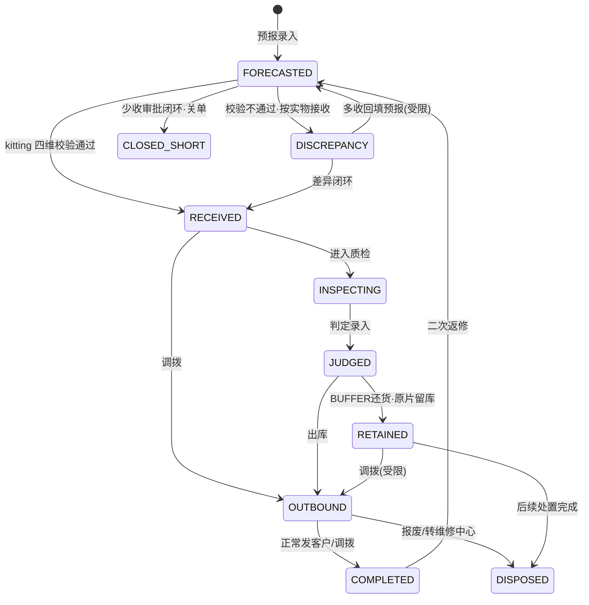
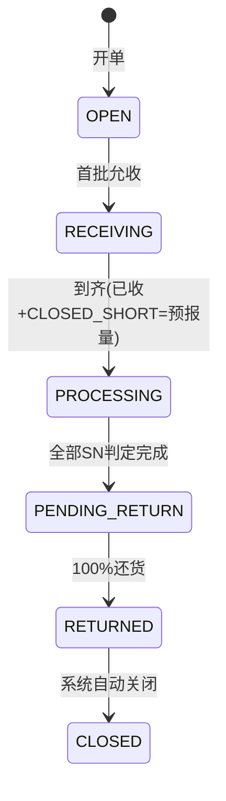

# BOE US RMA 收发管理系统

面向 **BOE US 售后退货仓** 的 RMA 全链路管理系统：从到货预报、物流允收、逐片 Kitting 扫码、差异审核、质检判定，到四类出库、按箱打包发运、还货闭环与 TAT 管控。

> 一期 MVP · 基线 **PRD V1.22**（含 D1~D10 终裁 + 功能评审 31 项 + 状态机评审 13 项 + UI/设计评审 9 项全部闭环）

| 项 | 说明 |
|---|---|
| 后端 | Go 1.22 · Gin · GORM · MySQL 8（开发可用 SQLite） |
| 前端 | Vue3 · Element Plus · Vite · 中英双语 |
| 对象存储 | MinIO（照片原图，保留 ≥2 年） |
| 认证 | JWT + 5 角色 RBAC |
| 部署 | Docker Compose（MySQL + MinIO + API + Nginx） |
| 规模 | 23 张表 · 86 条 EARS 需求 · 32 个自动化用例 |

---

## 一、业务背景

退货从客户发出到还货完成，中间要跨 **仓库、项目、质检/R&D** 三个角色，容易出现「货不对板、SN 串货、还货无凭据、超期无人管」。本系统把全链路固化为一条可追溯流水线：

```
预报录入 → 物流允收(POD) → Kitting 逐片扫码(四维校验) → 差异审核
   → 质检判定 → 三段式还货 → 出库(4类) → 逐箱打包 → 整单发运 → RMA 自动关闭
```

**刚性指标**：TAT = 完整收货 → 完整发货完成 **≤ 10 个自然日**（第 8 天预警、>10 天标红）。

---

## 二、核心业务规则（不可改）

1. **双层级跟踪**：箱/批次级管允收（POD 整批）；SN 单品级管 kitting 之后全链路。
2. **两套状态机**：SN 10 态、RMA 6 态，全部走唯一入口校验，**禁跳级、禁回退**。
3. **出库动作 ≠ SN 终态**：`COMPLETED` = 正常发客户/调拨完成；`DISPOSED` = 处置类终态（报废/转中心/留库后处置）；`RETAINED` 是中间态；`CLOSED_SHORT` 是终态。
4. **三段式还货**：判定 → 自动带出还货方式 → 出库对象。
5. **BUFFER 备件独立表**（不进 `sn_item`）；默认同 PN，**跨 PN 替代须项目人员审批**；选定即 `RESERVED` 预占防并发超扣。
6. **箱号两套独立序列，禁止重号**：收货箱 `BOE+YYMMDD+3位`（kitting 开箱生成）、发货箱 `OB+YYMMDD+3位`（打包生成）；单日 ≤999、跨日重置 001。
7. **差异分两类**：RECEIVING 差异审批通过**仅放行不改预报**；KITTING 差异审批通过**修正预报 → REVISED**；`FORECAST_ANOMALY` / `ARRIVAL_ANOMALY` 双异常记录**永久不可删**。
8. **RMA 无手工关闭按钮**：全部 SN 还货完成（`return_record` 计数达 100%，RETAINED 不阻断）→ 系统自动 `RETURNED→CLOSED`。
9. **二次返修仅 `COMPLETED` 允许**：历史轮次归档 `sn_item_round`、`return_count+1`；`RETAINED`/`DISPOSED`/`CLOSED_SHORT` 一律阻断。
10. **一期不做**：客户门户、第三方 API、离线缓存（断网禁提交）、`CANCELLED` 作废态。

### 三段式映射

| 判定 | 还货方式 | 原片去向 | 出库 |
|---|---|---|---|
| REPAIR | 原片修复 | ORIGINAL_SHIPPED | SHIP_TO_CUSTOMER → COMPLETED |
| REPAIR（修好入 buffer） | — | DISPOSED + buffer AVAILABLE | 无出库（转库存） |
| CID_RETURN | CID 还货 | ORIGINAL_SHIPPED | SHIP_TO_CUSTOMER（cid_flag） |
| REPLACE | BUFFER 还货 | RETAINED | 备件发客户，原片留库待处置 |
| SCRAP | BUFFER 还货 | SCRAPPED | 备件发客户 + 报废处置单（需审批） |
| TRANSFER_RC | BUFFER 还货 | TRANSFERRED_RC | 备件发客户 + 发维修中心单 |

---

## 三、状态机





---

## 四、目录结构

```
.
├── RMA收发系统_PRD_v1.22.md          # 需求基线
├── RMA收发系统_*评审*.md              # 功能/状态机/UI/设计评审
├── RMA_设计稿_v3.html                 # 高保真设计稿
└── mvp/
    ├── backend/                       # Go 后端
    │   ├── cmd/server/                # 入口
    │   └── internal/
    │       ├── enum/                  # 枚举常量（唯一权威，零裸字符串）
    │       ├── model/                 # GORM 模型 E1~E12
    │       ├── statemachine/          # SN 10 态 / RMA 6 态
    │       ├── seq/                   # BOE/OB 双箱号 + 通用单号
    │       ├── service/               # 业务编排（事务/审计/状态校验）
    │       ├── handler/               # HTTP 层
    │       ├── middleware/            # JWT + RBAC
    │       ├── router/                # 路由与权限绑定
    │       ├── storage/               # MinIO / 内存对象存储
    │       └── store/                 # 连接 / 迁移 / 种子
    ├── frontend/                      # Vue3 SPA（13 Web 页 + 移动端）
    ├── db/
    │   ├── schema.sql                 # MySQL 8 DDL（23 张表）
    │   └── enum_seed.sql              # 枚举字典 + 初始数据
    ├── openapi/openapi.yaml           # OpenAPI 3.0
    ├── deploy/                        # Dockerfile×2 / compose / nginx / rollback.sh
    └── docs/                          # 需求覆盖、风险台账、架构、测试、迭代门禁、审计、枚举
```

---

## 五、快速开始

### 本地开发（SQLite，零依赖）

```bash
cd mvp/backend
go run ./cmd/server            # :8080，自动建表 + 种子
```

```bash
cd mvp/frontend
npm install
npm run dev                    # :5173，代理 /api → :8080
```

### 生产部署（MySQL + MinIO + Nginx）

```bash
cd mvp/deploy
cp .env.example .env           # 改密码 / 端口 / JWT_SECRET
docker compose up -d --build   # 访问 http://localhost:8088
```

`db/schema.sql` 与 `db/enum_seed.sql` 会在 MySQL 容器首次启动时自动执行。

回滚：

```bash
cd mvp/deploy && ./rollback.sh 1.0.0
```

### 演示账号

| 角色 | 账号 / 密码 | 能做什么 |
|---|---|---|
| 项目人员 `project_staff` | `project` / `Proj@123` | 预报、差异审批、报废审批、跨PN审批、RETAINED 处置、报表、审计 |
| 仓库操作员 `warehouse_operator` | `warehouse` / `Wh@123` | 允收、Kitting 扫码、差异提交、出库、打包发运、箱标打印 |
| 质检员/R&D `inspector` | `inspector` / `Insp@123` | 质检判定（支持批量） |
| 系统管理员 `admin` | `admin` / `Admin@123` | 主数据、用户角色、报表、审计 |
| 客户/BOE US `customer` | `customer` / `Cust@123` | **一期不开放（登录 403）** |

---

## 六、关键实现

| 机制 | 做法 |
|---|---|
| 状态机防脏写 | `transit()` 唯一入口：行锁 + 跃迁表校验 + 条件更新，全程事务内 |
| BUFFER 防超扣 | `UPDATE ... SET stock_status='RESERVED' WHERE sn=? AND stock_status='AVAILABLE'`，`RowsAffected=0` 即冲突返回 409 |
| 箱号并发 | 事务内 `INSERT ... ON DUPLICATE KEY UPDATE current_no=current_no+1` 后回读 |
| 不可删除记录 | 应用层无删除接口；MySQL 触发器 `trg_dr_no_delete` / `trg_al_no_delete` / `trg_pe_no_delete` 兜底 |
| 审计留痕 | 14 类动作（状态流转/受控修正/审批/关闭/处置/发运/封箱/上传/登录…）与业务同事务写入 |
| 断网保护 | 前端 axios 拦截：离线时非 GET 直接拒绝，无本地缓存、无补传 |
| 箱标打印 | 后端返回打印专用 HTML，浏览器原生打印（100mm 标签） |

---

## 七、测试

```bash
cd mvp/backend
go test ./...      # 32 用例：状态机 5 / 箱号 4 / 业务闭环 20 / 接口权限 3
go vet ./...
npm --prefix ../frontend run build
```

当前结果：**32/32 通过**，9 项强制门禁全绿。详见 [`mvp/docs/04_测试报告.md`](mvp/docs/04_测试报告.md) 与 [`mvp/docs/05_迭代报告与门禁.md`](mvp/docs/05_迭代报告与门禁.md)。

---

## 八、文档索引

| 文档 | 内容 |
|---|---|
| [需求覆盖核对表](mvp/docs/01_需求覆盖核对表.md) | 86 条 EARS 需求逐条落点 |
| [风险 & 遗留台账](mvp/docs/02_风险台账.md) | 23 项口径缺口/环境限制/二期边界 |
| [架构与 ER](mvp/docs/03_架构与ER.md) | 分层、ER 图、并发控制、权限中间件 |
| [测试报告](mvp/docs/04_测试报告.md) | 32 用例 + 13 个缺陷根因分析 |
| [迭代报告与门禁](mvp/docs/05_迭代报告与门禁.md) | R1~R4 迭代 + 门禁校验明细 |
| [审计日志说明](mvp/docs/06_审计日志说明.md) | 动作字典与合规留存 |
| [枚举字典](mvp/docs/07_枚举字典.md) | 14 组枚举 + 三段式派生表 |
| [OpenAPI 3.0](mvp/openapi/openapi.yaml) | 全量接口契约 |
| [PRD V1.22](RMA收发系统_PRD_v1.22.md) | 需求基线 |

---

## 九、已知限制

- 容器化与 MySQL 8 实跑未在开发机验证（本机无 Docker/MySQL），CI 需补一次 `docker compose up` + DDL 初始化。
- `kitting` 四维校验中的「PN 一致」依赖现场补扫 PN（扫码只扫 SN 时跳过该维度）。
- 无浏览器 E2E（Playwright），前端为构建级验证。
- 5 处枚举/跃迁属必要扩展（`REJECTED`、`POD/BOX_LABEL/SHIPMENT`、`SCRAPPED`、退供应商承载、回填跃迁），待产品确认后回写 PRD 6.2。

完整清单见 [风险台账](mvp/docs/02_风险台账.md)。

---

## 十、分支与版本

- 默认分支：`main`
- 需求基线：PRD **V1.22**
- 交付版本：一期 MVP `1.0.0`
