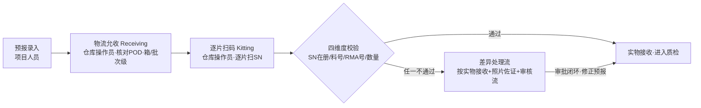
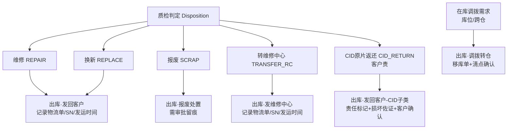
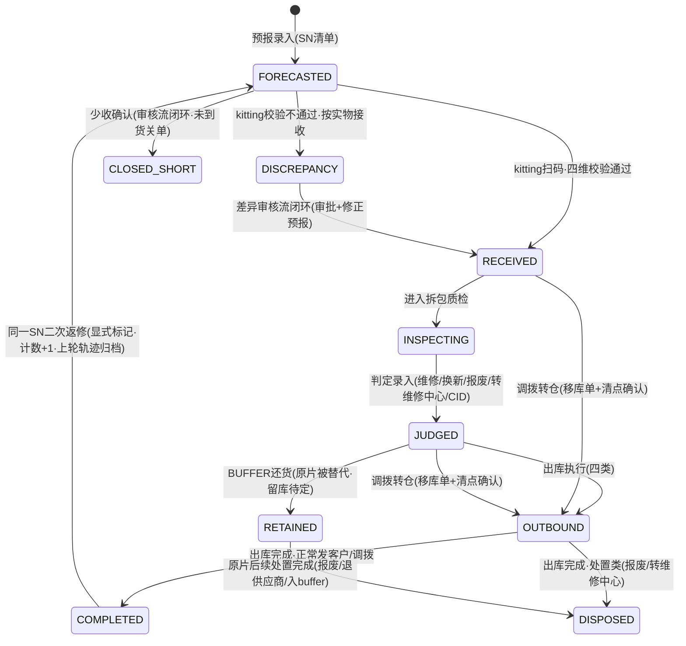
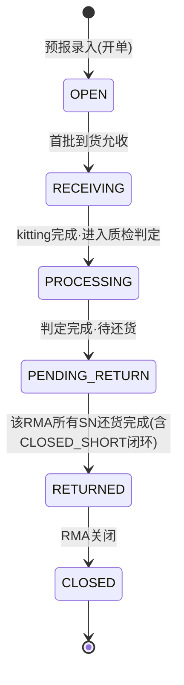

# BOE US RMA 收发管理系统 — 产品需求文档（PRD）

---

## 文档头

| 项目 | 内容 |
|---|---|
| **文档名称** | BOE US RMA 收发管理系统 产品需求文档（PRD） |
| **版本** | V1.22 |
| **编制日期** | 2026-11-03 |
| **需求来源** | 《BOE US RMA 收发管理系统 — 需求规划 v1》（已经两轮 grill-me 需求确认闭环） |
| **适用范围** | BOE US RMA 收发管理系统**一期（MVP）**的需求设计、开发、测试与验收基线。二期内容仅在依赖与后续规划章节说明，不在一期功能范围内设计。 |
| **阅读对象** | 研发团队（前后端/移动端）、测试团队、海外仓运营（仓库操作员/质检员/R&D）、项目组、系统管理员 |

### 修订记录

| 版本 | 日期 | 修订内容 | 修订人 |
|---|---|---|---|
| V1.0 | 2026-11-03 | 初稿：基于《需求规划 v1》编制，范围锁定一期 MVP | 项目组（产品） |
| V1.1 | 2026-11-03 | 口径确认：①报废出库审批人=项目人员；②调拨完成等同SN出库（→COMPLETED）；③预报SN清单支持Excel批量导入；④数量类差异照片口径明确（多收/少收）；⑤POD改为照片上传；⑥新增箱号编制+按箱录入界面+箱标打印（箱号+SN明细，编码规则待确认） | 项目组（产品） |
| V1.2 | 2026-11-03 | 箱号编码规则确认：`BOE + YYMMDD + 三位流水码`（示例 `BOE261103001`，流水码当日递增、跨日从 001 重置）；第 11 章留白项口径确认记录闭环 | 项目组（产品） |
| V1.3 | 2026-11-03 | 老丁终裁 D1~D5 冻结研发基线：①调拨等同出货终结生命周期（维持 OUTBOUND→COMPLETED）；②箱号流水码按箱递增、三位（不超 999）；③二次返修=单 sn_item 主记录+历史轮次表 sn_item_round；④引入 CLOSED_SHORT 少收终态；⑤CID 客户确认=项目人员确认即可、客户回复佐证选填。纳入专家补规则 R-NEW-1~5 | 项目组（产品） |
| V1.4 | 2026-11-03 | 补充还货闭环与 BUFFER 还货：RMA close=还货完成；还货方式 3 种（原片修复/CID/BUFFER）；新增 RMA 级状态机（6 态）；新增 BUFFER 缓冲备件管理模块；SN 状态加 RETAINED（原片被 buffer 替代后留库待定）；还货方式 SN 级，RMA close=该 RMA 所有 SN 还货完成；1 RMA=1 预报单可多批次到货 | 项目组（产品） |
| V1.5 | 2026-11-03 | 老丁终裁 D6~D10 + TAT：①D6 判定→还货方式→出库对象三段式重构（还货方式前移到判定后出库前）；②D7 RMA 进 PROCESSING=所有批次 kitting 完成；③D8 SCRAP/TRANSFER_RC 原片处置后仍需 BUFFER 还货、REPLACE 归非原片还货；④D9 RETAINED 改为"待处置中间态"+4 条处置路径（报废/退供应商/修好入buffer/长期留库）；⑤D10 REPAIR 修好后可选"原片还客户"或"入buffer复用"；⑥新增 TAT（RMA 完整收货→close 发货完成 ≤10 自然日）+ 超期预警 + TAT 报表 | 项目组（产品） |
| V1.6 | 2026-11-03 | ①BUFFER 还货规则：默认同 PN，不同 PN 替代需项目人员审批；②收货页面呈现 RMA 总量/已收/待收 + buffer 可用库存；③页面设计原则锁定"简洁"，风格在设计评审阶段确定 | 项目组（产品） |
| V1.7 | 2026-11-03 | 发货(shipping)按箱打包：①按箱打包界面，记录还货RMA/箱号/SN/重量/材积；②箱标打印；③打包完成发运须提交物流公司+物流单号；④新增发货箱实体 shipment_box | 项目组（产品） |
| V1.8 | 2026-11-03 | 功能评审 C-03/C-04/C-05/C-08 闭环：①TAT 终点=RMA完整发货完成时间（close 与发货完成为同一时点）；②SCRAP/TRANSFER_RC 各自对应出库单（SCRAP_DISPOSAL/SHIP_TO_RC），buffer件还货另记录；③发货箱号前缀改为 **OB**（OB+YYMMDD+三位流水），与收货箱 BOE 区分、不重号；④客户可见双异常记录 | 项目组（产品） |
| V1.9 | 2026-11-03 | 功能评审 C-01/C-02/C-06/C-07/C-09 闭环：①原片处置扩展为 4 值（发走/留库待定/报废SCRAPPED/转维修中心TRANSFERRED_RC）；②sn_status 新增统一终态 DISPOSED（处置后统一已处置，路径记 retained_disposition）；③多收实物不加 source 字段，以 forecast_no 为空判定；④所有核心表补 tenant_id（多租户）；⑤一期客户不访问系统，客户只读访问与门户全部二期 | 项目组（产品） |
| V1.10 | 2026-11-03 | 明确「出库动作」与「sn_status 终态」分离：COMPLETED=正常发客户/调拨完成；DISPOSED=处置类结束（报废/转维修中心/留库后处置，均走出库单）；RETAINED=留库未处置；报废也要走出库单（SCRAP_DISPOSAL），留库后报废同样出库→DISPOSED | 项目组（产品） |
| V1.11 | 2026-11-03 | 中优先级 M-01~M-14 全闭环：①RMA 关闭=系统自动；②还货方式系统自动带出、发货时录入还货SN并校验buffer库存SN；③不同PN buffer替代=独立审批流；④buffer件不进sn_item；⑤PROCESSING→PENDING_RETURN=全部SN判定完；⑥"到齐"=按预报总量判；⑦少收差异列未到SN逐SN关单；⑧REPAIR修好直接决定；⑨还货关联出库单+发货箱；⑩调拨复用三态；⑪一箱可混装多RMA；⑫补5项权限行；⑬照片全纳入≥2年；⑭全关键操作入审计 | 项目组（产品） |
| V1.12 | 2026-11-03 | 低优先级边界 L-01~L-08 收尾：①RETAINED未处置完不允许二次返修；②RETAINED可调拨；③备件单独报废流程；④少收按已收+CLOSED_SHORT=预报量判到齐（须审核流闭环）；⑤多收回填须审批闭环后计入还货/TAT；⑥一RMA可多PN、buffer按SN的PN匹配；⑦RMA close依据=是否100%还货（RETAINED不影响）；⑧报废审批驳回退回单可重提交 | 项目组（产品） |
| V1.13 | 2026-11-03 | 状态机专项评审修正：①D7「所有批次kitting完成」废弃，RECEIVING→PROCESSING 以 M-06「预报总量到齐」为唯一口径；②CLOSED_SHORT 视为"已处理完成"，不阻断 RMA 推进；③多收 SN 走差异审批，通过后先置 FORECASTED 再 RECEIVED；④一期不加作废态 | 项目组（产品） |
| V1.14 | 2026-11-03 | 专项评审 RK-04~RK-13 收尾：④仅 COMPLETED 可二次返修（DISPOSED 不可）；⑤LONG_RETAIN 永久保留不强制收尾；⑦仅 RECEIVED/JUDGED/RETAINED 可调拨；⑧迟到货新建收货记录重收（CLOSED_SHORT 保持终态）；⑨REPAIR_TO_BUFFER 允许同SN双身份关联；⑩buffer 增 RESERVED 预占防并发；⑪差异驳回自动解锁重扫；⑫跨PN替代仅项目人员审批（无需客户确认）；⑬"100%还货"按 return_record 计数 | 项目组（产品） |
| V1.15 | 2026-11-03 | 页面交互专项评审：①UX-01 删除 P-09「RMA 关闭操作」，RMA 状态只读展示、系统自动关闭、无手工关闭入口；②UX-16 确认一期不做客户只读视图（归二期） | 项目组（产品） |
| V1.16 | 2026-11-03 | P-09 页面「还货方式确定」改为「还货方式展示（系统自动带出）」，与 M-02 自动带出口径一致（UX-01b） | 项目组（产品） |
| V1.17 | 2026-11-03 | 设计评审决策落定：①UI 采用成熟组件库；②移动端扫码=点击逐个扫；③箱标=浏览器打印；④界面中英双语（非功能需求补充） | 项目组（产品） |
| V1.18 | 2026-11-03 | 设计评审决策（续）：⑤差异工作台 3 Tab（待审/已处理/双异常查询）；⑥出库管理按出库类型 4 Tab；⑦还货看板仅列表（TAT标红，不做图表）；⑧移动端断网禁止提交、恢复重试；⑨客户只读视图纳入二期 | 项目组（产品） |
| V1.19 | 2026-11-03 | 新增 Web 版扫码作业页：P-11 Kitting 扫码(Web)、P-12 出库打包扫码(Web)，适配"电脑+扫码枪"作业；扫码枪=键盘模拟输入（扫入即自动校验）；非功能扫码兼容性补充 | 项目组（产品） |
| V1.20 | 2026-11-03 | 页面信息架构调整：①P-03 物流允收以 **RMA号/Buffer订单号** 为索引，点击跳转"按箱收货"详情页；②P-04 差异审核以 **RMA号/订单号** 为索引；③P-06 出库管理以 **出库单/RMA** 为行、点击进详情看多 SN（列表不铺 SN）；④**移除收货页(允收/kitting)的 Buffer 可用/占用显示**，BUFFER 仅在还货看板/订单详情展示（RC-08 调整） | 项目组（产品） |
| V1.21 | 2026-11-03 | 物流允收与 kitting 职责理清：①**物流允收(receiving)只确认到货箱数 + POD，不开箱、不点 SN、不涉料号、不生成箱号**；②**收货箱号在 kitting 开箱时生成**（BOE+YYMMDD+三位流水），按箱录入 SN、封箱打印箱标；③发货箱号打包时生成（OB+…）；④打包=逐箱打包+每箱箱标，发运=整单发运（多箱共用物流单号） | 项目组（产品） |
| V1.22 | 2026-11-03 | 交互细化：①物流允收改为**清点外箱标识数量 vs 预报数量**（预报无箱数维度），差异进审核；②差异按来源区分——**允收差异审核通过→进 kitting、不改预报；kitting 差异审核通过→更新预报(REVISED)**；③质检支持**多选 SN 批量提交**；④所有列表每页条数可选 **10/20/50/200** | 项目组（产品） |

### 术语约定

| 术语 | 英文标识 | 说明 |
|---|---|---|
| 预报 | Forecast | 项目人员提前录入的到货预报（含 SN 清单 + 料号 + RMA 号 + 数量） |
| 物流允收 | Receiving | 整批到货验收，核对物流 POD，箱/批次级管理 |
| 逐片扫码 | Kitting | 逐片扫实物 SN 并执行四维度校验，SN 单品级管理起点 |
| 差异 | Discrepancy | kitting 四维度校验任一不通过的情形 |
| 预报异常 | Forecast Anomaly | 差异闭环时永久保留的预报侧异常记录 |
| 到货异常 | Arrival Anomaly | 差异闭环时永久保留的到货侧异常记录 |
| 质检 | Inspection | 质检员/R&D 拆包质检 |
| 判定 | Disposition | 质检后录入的 RMA 处理结论 |
| 出库 | Outbound | 四类出库：发回客户 / 发维修中心 / 报废处置 / 调拨转仓 |
| CID 原片返还 | CID Return | 客户责（CID）判定下原片不维修/不换新直接返还客户，属"发回客户"子类 |
| POD | Proof of Delivery | 物流签收凭证 |
| SN | Serial Number | 产品序列号，每片唯一 |
| PN | Part Number | 料号 |
| RMA 号 | RMA No. | 退货授权单号 |
| 还货 | Return | RMA 关闭前的还货闭环动作；方式 3 种：原片修复 / CID / BUFFER |
| BUFFER 还货 | Buffer Return | 用缓冲备件替代原片还货，原片留库待定 |
| 缓冲备件 | Buffer Stock | 提前入库的良品备件（新品 / 维修良品），用于 BUFFER 还货 |
| 租户 | Tenant | 数据隔离单元，一期单租户运行、模型预留多租户 |

> **编写约定**：本文所有需求条目采用 EARS 句式，标注类型：`U`(Ubiquitous 系统始终满足)、`E`(Event-driven 事件触发)、`W`(Unwanted 异常处理)、`S`(State-driven 状态驱动)、`O`(Optional 可选功能)。需求编号规则：模块前缀-序号（FC 预报 / RC 允收 / KT Kitting / DC 差异 / IN 质检判定 / OB 出库 / SN 单品追踪 / PH 照片 / MD 主数据 / RP 报表）。

---

## 1. 业务背景 & 项目目标

### 1.1 业务背景

我方承接 BOE 美国（BOE US）的 RMA 售后退货服务，提供提货、接收、检测、仓储、再发货等全链路服务。当前依靠人工 + 表格管理收发，运行中暴露出以下瓶颈：

1. **货不对板**：外箱仅标注料号 / RMA 号 / 数量，**不含 SN**；SN 在"逐片扫码接收(kitting)"环节才逐片扫出。研发进场拆包装检测后，实物 SN 与箱子、预报失去对应关系，无法核对。
2. **账实不符风险**：收货清点靠人工，差异发现滞后，且拆包后无系统留痕。
3. **SN 追踪混乱**：缺少 SN 全局唯一索引，二次返修、跨单流转难以追溯。
4. **状态不可视**：客户 / BOE US 无法实时查看退货状态与轨迹。

### 1.2 项目目标（一期 MVP 优先级）

**一期优先级 = 收发清点 + 货不对板核验 + SN 唯一性追踪**，对应三大系统能力：

1. 逐片扫码（kitting）四维度校验，把"货不对板"挡在研发拆包之前；
2. 差异异常审核流，按实物接收并保留双异常记录（预报异常 + 到货异常）；
3. SN 全局唯一索引，支撑全生命周期追踪与二次返修。

### 1.3 明确边界

- **系统不涉及请款相关逻辑**：SN 唯一性仅用于全生命周期追踪与防串货，不做请款、计费、结算功能。
- **一期不接外部系统 API**：主数据手动 / Excel 导入，POD 手动上传（BOE US / 物流商 API 对接为二期）。
- **RMA 信息不涉及私人数据**，暂不适用跨境数据合规框架；基础传输 / 存储加密保留。

---

## 2. 业务范围

### 2.1 「收」—— 入仓流程

| 环节 | 操作角色 | 说明 | 关键动作 |
|---|---|---|---|
| 预报录入 | 项目人员 | 提前将退货预报录入系统 | 录入 SN 清单 + 料号 + RMA 号 + 数量 |
| 物流允收 (receiving) | 仓库操作员 | 到货验收（**清点外箱标识数量，不开箱**） | 核对各外箱标识数量合计 vs 预报数量 + 上传 POD |
| 逐片扫码 (kitting) | 仓库操作员 | 逐片扫实物 SN | 系统比对预报，四维度校验；不通过进入差异处理流 |

### 2.2 「发」—— 出库流程（共 4 类，均需系统管理）

| 出库类型 | 英文标识 | 触发条件 | 关键记录 |
|---|---|---|---|
| 修好 / 换新发回客户 | SHIP_TO_CUSTOMER | 判定结果 = 维修(REPAIR) / 换新(REPLACE) | 物流单号、SN、发运时间 |
| 发往维修中心 / 代工厂 | SHIP_TO_RC | 判定结果 = 转维修中心(TRANSFER_RC) | 物流单号、SN、发运时间 |
| 报废 / 处置出库 | SCRAP_DISPOSAL | 判定结果 = 报废(SCRAP) | **需审批留痕** |
| 调拨 / 转仓 | TRANSFER_WAREHOUSE | 库内库位 / 跨仓调拨（不由判定触发） | **需移库单与清点确认；完成等同于 SN 出库** |
| CID（客户责）原片返还 | SHIP_TO_CUSTOMER（子类） | 判定结果 = CID 原片返还(CID_RETURN) | **责任标记 + 损坏佐证照片 + 客户确认记录** |

> **CID 说明**：CID（客户责）原片返还属**判定节点分支**，出库归入"发回客户"子类；原片不维修 / 不换新、直接返还客户。

### 2.3 还货闭环与 RMA 关闭（V1.4 新增）

**核心规则：RMA 的 close = 对应还货完成。** 出库 ≠ 关单，必须完成"还货"动作才能关闭 RMA。

**还货方式（3 种，按 SN 级确定，同一 RMA 内不同 SN 可不同方式）：**

| 还货方式 | 英文标识 | 含义 | 对应判定/出库 |
|---|---|---|---|
| 原片修复还货 | ORIGINAL_REPAIR | 原片维修后发回客户 | 判定 REPAIR + 出库 SHIP_TO_CUSTOMER（原片） |
| CID 还货 | CID_RETURN | 客户责原片不维修直接返还客户 | 判定 CID_RETURN + 出库 SHIP_TO_CUSTOMER（cid_flag，原片） |
| BUFFER 还货 | BUFFER_RETURN | 用缓冲备件替代原片还货，**原片留库待定** | 取 buffer 备件出库 SHIP_TO_CUSTOMER（buffer 件）；原片标记 RETAINED |

**RMA 关闭条件**：该 RMA 下所有 SN 均完成还货（少收 CLOSED_SHORT 的 SN 视为已闭环）。全部还货完成 → RMA 状态 RETURNED → CLOSED。

> 1 RMA = 1 预报单（forecast_order），可分多批次到货（1 : N 允收批次）。

---

## 3. 用户角色与权限矩阵

**角色固定为 5 类，不新增角色。**

| 角色 | 英文标识 | 职责概述 |
|---|---|---|
| 仓库操作员 | warehouse_operator | 物流允收、逐片扫码(kitting)、拣货包装出库 |
| 项目人员 | project_staff | 预报录入、差异审核流处理、客户沟通、到货预报修正 |
| 质检员 / R&D | inspector | 拆包质检、RMA 判定录入 |
| 客户 / BOE US | customer | 查看退货状态与轨迹（**只读**） |
| 系统管理员 | admin | 权限管理、主数据管理 |

### 权限矩阵（✅ 可操作 / 👁 只读 / — 无权限）

| 功能 | 仓库操作员 | 项目人员 | 质检员/R&D | 客户/BOE US | 系统管理员 |
|---|:---:|:---:|:---:|:---:|:---:|
| 主数据（产品/机型/PN）维护与 Excel 导入 | — | ✅ | — | — | ✅ |
| 用户 / 角色管理 | — | — | — | — | ✅ |
| 预报录入 | — | ✅ | — | — | — |
| 到货预报修正（受控） | — | ✅ | — | — | — |
| 物流允收（receiving，POD 上传） | ✅ | — | — | — | — |
| 逐片扫码（kitting） | ✅ | — | — | — | — |
| 差异现场提交（含佐证照片上传） | ✅ | — | — | — | — |
| 差异审核流处理（审批） | — | ✅ | — | — | — |
| 已提交数据受控修正（含审计留痕） | — | ✅ | — | — | — |
| 拆包质检 / 判定录入 | — | — | ✅ | — | — |
| CID 客户确认记录录入 | — | ✅ | — | — | — |
| 拣货包装出库扫描 | ✅ | — | — | — | — |
| 出库单创建 / 物流单号登记 | ✅ | — | — | — | — |
| 报废处置出库审批 | — | ✅ | — | — | — |
| BUFFER 备件入库（预报） | — | ✅ | — | — | — |
| BUFFER 备件入库（receiving / kitting 扫码） | ✅ | — | — | — | — |
| 箱标打印（收货 / 发货） | ✅ | — | — | — | — |
| 发货打包 / 发运提交（物流信息） | ✅ | — | — | — | — |
| RETAINED 原片处置 | — | ✅ | — | — | — |
| TAT 看板查看 | 👁 | ✅ | 👁 | 👁 | ✅ |
| 调拨移库单创建与清点确认 | ✅ | — | — | — | — |
| 状态 / 轨迹查询、基础报表 | 👁 | ✅ | 👁 | 👁 | ✅ |
| 差异双异常记录查看 | 👁 | ✅ | 👁 | 👁 | ✅ |
| 审计日志查看 | — | ✅ | — | — | ✅ |

> ① 客户/BOE US 为只读角色，**一期不访问系统**（数据由项目人员导出 / 线下同步）；客户只读访问与独立门户**全部二期交付**（C-09，V1.9）。一期仅完成角色与权限模型定义。
> ② 客户/BOE US **可见**差异双异常记录（C-08，V1.8；二期开放客户访问后生效）。
> ③ **RMA 关闭由系统自动执行**（所有 SN 还货完成即自动 CLOSED，无需人工操作；M-01，V1.11）。

---

## 4. 业务主流程、分支流程、异常流程

### 4.1 跟踪粒度（双层级，刚性规则）

- **箱 / 批次级**：管理"物流允收(receiving)"，POD 为整批；收货环节同步编制**箱号**并打印箱标（箱号 + SN 明细），见 5.2 RC-05 ~ RC-07；
- **SN 单品级（逐片）**：管理 kitting 之后的全链路（质检、判定、出库）。

### 4.2 SN 级生命周期状态机

### 4.2-B RMA 级状态机（V1.4 新增）

| RMA 状态 | 英文标识 | 进入条件 |
|---|---|---|
| 开单 | OPEN | 预报录入（RMA 单建立） |
| 收货中 | RECEIVING | 首批到货允收；可多批次到货 |
| 处理中 | PROCESSING | kitting 完成、进入质检判定 |
| 待还货 | PENDING_RETURN | 判定完成，等待还货 |
| 已还货 | RETURNED | 该 RMA 所有 SN 还货完成（少收 CLOSED_SHORT 视为闭环） |
| 已关闭 | CLOSED | RMA 关闭（终态） |

> **RMA 推进规则（V1.13）**：RMA 由 SN 状态聚合自动推进——RECEIVING→PROCESSING = **到齐判定**（已收数量 + CLOSED_SHORT 数量 = 预报数量，且少收差异审核流已闭环；**D7「所有批次 kitting 完成」口径废弃，以此为准**，RK-01）；PROCESSING→PENDING_RETURN = 该 RMA 所有 SN 判定完成（**CLOSED_SHORT 视为已处理完成，不阻断推进**，M-05/RK-02）；PENDING_RETURN→RETURNED→CLOSED = **依据是否 100% 还货**（所有 SN 的还货件均已发出即算，**RETAINED 原片留库不影响**，L-07）；RMA 关闭由**系统自动执行**（M-01）；**「100% 还货」按 `return_record` 计数**——每片退货 SN 对应一条还货记录（含 returned_sn），全部有记录即 100%（RK-13，V1.14）。

### 4.3 主流程（文字描述）

1. 项目人员录入到货预报：RMA 号 + 料号(PN) + 预报数量 + SN 清单；
2. 整批到货，仓库操作员做物流允收（receiving）：核对并上传物流 POD，箱/批次级确认到货；
3. 仓库操作员逐片扫码（kitting），系统对每件实物执行**四维度校验**：
   - ① SN 是否在预报清单内（不在 = 来路不明 / 未预报）
   - ② 料号 / PN 是否一致
   - ③ RMA 号是否一致
   - ④ 数量是否一致（多收 / 少收）
4. 校验通过 → 实物接收，SN 进入 `RECEIVED`，可安排质检；
5. 质检员 / R&D 拆包质检，录入判定结果：维修 / 换新 / 报废 / 转维修中心 / CID 原片返还(客户责)；
6. 按判定结果执行对应类型出库（四类），记录物流单、SN、发运时间 / 审批留痕 / 移库单清点确认 / CID 责任记录；
7. 出库完成，SN 生命周期 `COMPLETED`。

### 4.4 分支流程

- **CID（客户责）原片返还**：判定为 CID 时，原片不维修 / 不换新、直接返还客户；出库归入"发回客户"子类，必须记录**责任标记 + 损坏佐证照片 + 客户确认记录**。
- **二次返修**：同一 SN 在新一轮预报中再次出现且上一轮生命周期已完结时，系统将上一轮轨迹归档，返修计数 +1，并**显式标记二次返修**，进入新一轮 `FORECASTED`。
- **调拨 / 转仓**：不由判定触发，由库位 / 跨仓调拨需求发起，需移库单与清点确认；**调拨完成等同于 SN 出库**，SN 状态进入 `OUTBOUND` → `COMPLETED`（生命周期终态，等同于该 SN 在本系统内一轮收发流程结束）。

### 4.5 异常流程（差异处理）

1. kitting 四维度校验**任一不通过** → 该件实物进入差异处理流，**按实物接收（不硬阻断入库）**；
2. 差异 pcs 须**上传佐证照片（含 SN / PN 信息）**；
3. 系统自动生成**审核流**（状态 `PENDING`）；
4. 项目人员与客户沟通厘清 → 按实际情况审批（审批人统一为**项目人员**，系统实际操作使用项目人员账号）；
5. 审批后**修正到货预报**（预报单状态 → `REVISED`），但**永久保留双异常记录**：`预报异常(FORECAST_ANOMALY)` + `到货异常(ARRIVAL_ANOMALY)`，任何角色不得删除；
6. 差异闭环后 SN 回到 `RECEIVED`，恢复正常主流程。

### 4.6 澄清注记

- **数据锁定与受控修正**：现场提交（kitting / 异常）后**不允许随意变更**；错扫 / 漏扫情况下，经**项目人员同意**可修正已提交数据，修正**全程留痕（审计轨迹）**。

---

## 5. 核心功能详细需求

### 5.1 预报管理（Forecast Management）

**功能概述**：项目人员提前录入退货预报，作为 kitting 四维度校验的比对基准。

| 编号 | EARS | 需求描述 |
|---|---|---|
| FC-01 | U | 系统应当支持项目人员录入到货预报，内容包含 RMA 号、料号(PN)、机型、预报数量、客户与 SN 清单；**一个 RMA 可含多个 PN，buffer 还货按每片 SN 的 PN 匹配同 PN 备件**（L-06，V1.12）。 |
| FC-02 | E | 当项目人员提交预报单时，系统应当校验 SN 清单条数与预报数量一致，不一致时阻止提交并提示。 |
| FC-03 | U | 系统应当对 SN 建立（tenant 维度的）全局唯一索引。 |
| FC-04 | E | 当预报 SN 清单中存在系统内已有记录的 SN 时，系统应当提示二次返修确认；经确认后显式标记二次返修并累计返修次数。 |
| FC-05 | S | 预报单处于已录入（ENTERED）状态后，系统应当锁定其原始数据，不允许现场随意变更。 |
| FC-06 | E | 当差异审核流审批通过时，系统应当按实际情况修正到货预报（状态 → REVISED），同时保留修正前后的完整数据。 |
| FC-07 | W | 如果预报录入的料号(PN)在主数据中不存在，则系统应当阻止提交并提示先维护主数据。 |
| FC-08 | E | 当项目人员录入预报时，系统应当支持 SN 清单**Excel 批量导入**；导入条数须与预报数量一致，不一致时阻止提交并提示。 |

### 5.2 物流允收（Receiving / POD）

**功能概述**：整批到货的箱 / 批次级验收管理。

| 编号 | EARS | 需求描述 |
|---|---|---|
| RC-01 | E | 当整批货物到货时，仓库操作员应当在系统中创建允收批次并关联预报单，上传物流 **POD 照片（支持多张）**完成允收。 |
| RC-02 | U | 系统应当在箱 / 批次级管理物流允收（POD 为整批），允收记录包含批次号、关联预报单、POD 照片、允收人、允收时间。 |
| RC-03 | E | 当允收批次提交后，系统应当锁定允收数据；错扫 / 漏扫类更正须经项目人员同意后受控修正并留痕。 |
| RC-04 | S | SN 明细在完成允收的批次下方可进行逐片扫码（kitting）。 |
| RC-05 | E | **（归属 kitting，V1.21）** 当 kitting 开箱时，系统应当按规则**生成收货箱号**：`BOE + YYMMDD + 三位流水码`（示例 `BOE261103001`）；流水码按箱递增、当日跨日从 001 重置、单日≤999。 |
| RC-06 | U | **（归属 kitting）** 系统应当提供按箱录入界面：kitting 开箱时**新建箱号**后逐片扫码 SN，形成箱内 SN 明细。 |
| RC-07 | E | **（归属 kitting）** 当箱内 SN 明细录入完成、**封箱**时，系统应当提供箱标打印（标签 = 箱号 + SN 明细）。 |
| RC-08 | U | 物流允收页面呈现 **预报数量 / 外箱标识数量合计 / 差异 / POD / 允收状态**；kitting 页面呈现 RMA SN 总量/已扫/待扫；均不显示 BUFFER（V1.22）。 |

### 5.3 Kitting 逐片扫码校验

**功能概述**：仓库操作员逐片扫实物 SN，系统实时执行四维度校验，是防"货不对板"的核心关卡。

| 编号 | EARS | 需求描述 |
|---|---|---|
| KT-01 | E | 当仓库操作员逐片扫入实物 SN 时，系统应当实时执行四维度校验：① SN 在预报清单内；② 料号(PN)一致；③ RMA 号一致；④ 数量一致（多收/少收）。 |
| KT-02 | E | 当任一校验不通过时，系统应当即时提示差异类型，并将该件实物标记为差异、进入差异处理流（按实物接收）。 |
| KT-03 | U | 系统应当兼容一维码与二维码，仅按 SN 字符串匹配，不绑定码制。 |
| KT-04 | E | 当仓库操作员提交 kitting 结果时，系统应当锁定提交数据，不允许现场随意变更。 |
| KT-05 | W | 如果发生错扫 / 漏扫，则经项目人员同意后可修正已提交数据，系统应当记录全程审计留痕（修正前后值、原因、操作人、时间）。 |
| KT-06 | S | SN 仅在处于 RECEIVED 状态（差异已闭环）时方可进入质检环节。 |
| KT-07 | E | 当 kitting 开箱时，操作员新建箱号，系统应当自动生成**收货箱号** `BOE + YYMMDD + 三位流水码`（按箱递增、跨日从 001 重置、≤999）；该箱号归集逐片扫码的 SN（V1.21）。 |
| KT-08 | E | 当一箱 SN 扫码完成并点「封箱」时，系统应当锁定该箱并打印**箱标（箱号 + SN 明细）**（V1.21）。 |

### 5.4 差异审核流程（Discrepancy Approval）

**功能概述**：到货差异按实物接收，照片佐证 + 项目人员审核流 + 修正预报 + 永久双异常记录。

| 编号 | EARS | 需求描述 |
|---|---|---|
| DC-01 | U | 差异按实物接收，系统不因差异阻断实物入库。 |
| DC-02 | E | 当差异被现场提交时，系统应当要求上传含 SN / PN 信息的佐证照片后方可提交。 |
| DC-03 | E | 当差异提交完成后，系统应当自动生成审核流（状态 PENDING），并通知项目人员处理。 |
| DC-04 | E | 当项目人员与客户沟通厘清并按实际情况审批后，系统应当记录审批结果（审批人、时间、说明）并触发到货预报修正；**审批驳回时系统自动解锁该差异件，允许仓库重扫（重扫走受控修正、留审计痕）**（RK-11，V1.14）。 |
| DC-05 | U | 系统应当永久保留预报异常(FORECAST_ANOMALY)与到货异常(ARRIVAL_ANOMALY)双份记录，任何角色不得删除。 |
| DC-06 | S | 差异记录处于 PENDING 状态期间，相关 SN 保持 DISCREPANCY 状态，不得进入质检。 |
| DC-07 | E | 当差异类型为**多收（QTY_OVER）**时，系统应当要求佐证照片包含：开箱后箱子内容物 + 箱子标签（含数量）+ 多收实物的 PN / SN 信息。 |
| DC-08 | E | 当差异类型为**少收（QTY_SHORT）**时，系统应当要求佐证照片包含：开箱后箱子内容物 + 箱子标签（含数量）。 |
| DC-09 | E | 当少收差异经审核流确认后，系统应当按差异记录中**列出的未到货 SN 清单**，逐 SN 标记为 `CLOSED_SHORT`（终态）关单，不长期停留 FORECASTED（M-07，V1.11）。 |
| DC-10 | E | 当 `CLOSED_SHORT` 的 SN 迟到货（客户补发）时，系统应当通过**新建收货记录**重新接收进系统，原 `CLOSED_SHORT` 记录保持终态（RK-08，V1.14）。 |
| DC-11 | E | 差异按来源区分并设不同审核后果（V1.22）：**RECEIVING 差异**（物流允收：外箱标识数量 vs 预报数量）审核通过后**放行进 kitting、不修改预报数量**；**KITTING 差异**（逐片扫码 SN 不符）审核通过后**修正预报（REVISED）**。 |

### 5.5 质检判定（Inspection & Disposition）

**功能概述**：质检员 / R&D 拆包质检并录入 RMA 判定结果。

| 编号 | EARS | 需求描述 |
|---|---|---|
| IN-01 | E | 当质检员 / R&D 完成拆包质检后，应当在系统中录入判定结果：维修(REPAIR) / 换新(REPLACE) / 报废(SCRAP) / 转维修中心(TRANSFER_RC) / CID 原片返还(CID_RETURN)。 |
| IN-02 | E | 当判定结果为 CID（客户责）原片返还时，系统应当要求记录**责任标记 + 损坏佐证照片**并由**项目人员确认**后方可提交判定；客户回复佐证为**选填**。 |
| IN-03 | S | 系统应当仅允许处于 RECEIVED 状态（差异已闭环）的 SN 进入质检（INSPECTING）。 |
| IN-04 | W | 如果质检对象在系统中不处于可质检状态，则系统应当拒绝录入并提示当前状态。 |

**判定 → 还货方式 → 出库对象 三段式映射（V1.5 重构，开发实现依据）**：

> 还货方式在**判定之后、出库之前**确定（D6）；出库对象由还货方式决定。

| 判定结果 | 可选还货方式 | 出库对象（发客户） | 原片处置 |
|---|---|---|---|
| REPAIR 维修 | ORIGINAL_REPAIR 原片修复还 / BUFFER_RETURN 入 buffer 复用 | 原片 / buffer 件 | 原片发走（ORIGINAL_SHIPPED）/ RETAINED（修好入 buffer 等） |
| REPLACE 换新 | BUFFER_RETURN（非原片还货） | buffer 件 / 新件 | 原片 RETAINED |
| SCRAP 报废 | BUFFER_RETURN（原片报废，客户需 buffer 还货） | buffer 件 | 原片报废（SCRAPPED） |
| TRANSFER_RC 转维修中心 | BUFFER_RETURN（原片转走，客户需 buffer 还货） | buffer 件 | 原片发维修中心（TRANSFERRED_RC） |
| CID_RETURN 客户责原片返还 | CID_RETURN 原片返还 | 原片（cid_flag） | 原片发走（ORIGINAL_SHIPPED） |
| 调拨（不由判定触发） | — | — | TRANSFER_WAREHOUSE，完成等同出库 → COMPLETED |

> **D8 要点**：SCRAP / TRANSFER_RC 的原片虽已处置，但 RMA 对客户仍需 BUFFER 还货才能 close；REPLACE 归非原片还货（BUFFER_RETURN）。

### 5.6 出库管理（Outbound）

**功能概述**：四类出库的执行与记录管理，仓库操作员通过移动端完成拣货包装出库扫描。

| 编号 | EARS | 需求描述 |
|---|---|---|
| OB-01 | U | 系统应当管理四类出库：发回客户(SHIP_TO_CUSTOMER)、发维修中心(SHIP_TO_RC)、报废处置(SCRAP_DISPOSAL)、调拨转仓(TRANSFER_WAREHOUSE)。 |
| OB-02 | E | 当出库类型为发回客户 / 发维修中心时，系统应当记录物流单号、SN 与发运时间。 |
| OB-03 | E | 当出库类型为报废 / 处置时，系统应当要求**项目人员**完成审批留痕（审批人 / 时间 / 意见强制必填）后方可执行出库；**审批驳回时退回该报废出库单（状态 REJECTED，可重提交），原片状态不变**（L-08，V1.12）。 |
| OB-04 | E | 当出库类型为调拨 / 转仓时，系统应当生成移库单并要求清点确认后完成出库；**调拨完成等同于 SN 出库**（OUTBOUND → COMPLETED）；**仅 RECEIVED / JUDGED / RETAINED 状态的 SN 可调拨**（L-02 / RK-07，V1.14）。 |
| OB-05 | E | 当出库为 CID 原片返还（发回客户子类）时，系统应当携带责任标记、损坏佐证照片与客户确认记录。 |
| OB-06 | E | 当仓库操作员完成拣货包装并执行出库扫描时，系统应当逐片核验 SN 后完成出库，SN 状态更新为 OUTBOUND。 |
| OB-07 | E | 当执行发货(shipping)时，系统应当提供**按箱打包界面**，记录还货 RMA 号、发货箱号、箱内 SN 清单、**重量(weight)**、**材积(volume)**（V1.7）。 |
| OB-08 | E | 当发货箱打包完成后，系统应当提供**箱标打印选项**，标签内容包含：还货 RMA、箱号、SN 明细、重量、材积（V1.7）。 |
| OB-09 | E | 当打包完成发运时，仓库操作员应当提交**物流公司(carrier)**与**物流单号(tracking_no)**后方可完成发运（V1.7）。 |
| OB-10 | U | 发货箱号(shipment_box_no)编码规则：**`OB + YYMMDD + 三位流水码`**（按箱递增、当日跨日从 001 重置），与收货箱号（BOE 前缀）区分、**不允许重号**（C-04，V1.8）。 |
| OB-11 | E | 当判定为 SCRAP / TRANSFER_RC 时，系统应当按各自场景生成对应出库单：SCRAP → 报废处置出库单(SCRAP_DISPOSAL)；TRANSFER_RC → 发维修中心出库单(SHIP_TO_RC)；buffer 件还货另按 SHIP_TO_CUSTOMER 记录（C-03，V1.8）。 |

### 5.7 SN 全生命周期追踪（SN Lifecycle Tracking）

**功能概述**：SN 单品级全链路追踪，含全局唯一、二次返修、轨迹时间线。

| 编号 | EARS | 需求描述 |
|---|---|---|
| SN-01 | U | 系统应当对 SN 建立全局唯一索引（tenant 维度），用于全生命周期追踪与防串货。 |
| SN-02 | E | 当同一 SN 在新预报中再次出现且上一轮**处于 COMPLETED（正常发客户）**时，系统应当将上一轮轨迹归档至**历史轮次表 sn_item_round**、返修计数 +1、显式标记二次返修，并进入新一轮 FORECASTED；sn_item 主记录保持全局唯一（索引落在 sn_item.sn）；**若上一轮为 RETAINED 或 DISPOSED，不允许二次返修**（L-01，V1.12 / RK-04，V1.14）。 |
| SN-03 | U | 系统应当提供 SN 全生命周期轨迹查询：预报 → 允收 → kitting → 差异（如有）→ 质检 → 判定 → 出库，含各环节时间、操作人、关联照片与差异记录。 |
| SN-04 | U | 系统不涉及请款相关逻辑。 |
| SN-05 | E | 当差异类型为多收（SN_NOT_IN_FORECAST）按实物接收时，系统应当为该实物新建 sn_item，并以 **`forecast_no 为空`** 标识其为未预报实物（不新增 source 字段，C-06，V1.9），归属差异记录；**多收 SN 走差异审批，审批通过后状态先置 FORECASTED 再转 RECEIVED**（RK-03，V1.13）；闭环后该 SN 才计入目标 RMA 的还货进度与 TAT（L-05，V1.12）。 |

### 5.8 照片管理（Photo Management）

**功能概述**：差异佐证照片与 CID 损坏佐证照片的存储管理。

| 编号 | EARS | 需求描述 |
|---|---|---|
| PH-01 | U | 照片应当存储于云端对象存储，按退货单 / SN 关联，保存原图 + 缩略图。 |
| PH-02 | W | 如果单张照片超过 10MB，则系统应当拒绝上传并提示。 |
| PH-03 | U | 照片应当保留 ≥2 年或按合同约定；**范围含差异/CID 佐证照片、POD 照片、箱标打印记录、发货相关图片**（M-13，V1.11）。 |
| PH-04 | E | 当差异现场提交或 CID 判定提交时，系统应当将照片与对应业务记录（差异记录 / SN）绑定存储。 |

### 5.9 基础主数据管理（Master Data）

**功能概述**：产品 / 机型 / PN 主数据维护与用户角色管理。

| 编号 | EARS | 需求描述 |
|---|---|---|
| MD-01 | U | 系统应当支持产品 / 机型（Product Model）与料号（PN）主数据维护，由项目人员维护或 Excel 批量导入。 |
| MD-02 | U | 系统应当支持系统管理员进行用户与角色管理（5 类角色，见第 3 章）。 |
| MD-03 | E | 当主数据 Excel 导入时，系统应当校验字段完整性与重复性，异常行提示并阻止导入。 |

### 5.10 查询与报表（Query & Reports）

**功能概述**：状态 / 轨迹查询与四维度基础报表。

| 编号 | EARS | 需求描述 |
|---|---|---|
| RP-01 | U | 系统应当提供按 RMA 号 / 客户维度的退货查询与汇总。 |
| RP-02 | U | 系统应当提供按 SKU（机型 / PN）维度的退货统计。 |
| RP-03 | U | 系统应当提供按周期（周 / 月）的退货量趋势。 |
| RP-04 | U | 系统应当提供差异 / 异常统计与出库类型分布（含 CID 占比）。 |
| RP-05 | U | 报表字段口径应当包含：SN、PN、RMA 号、状态、入库时间、出库时间、判定结果、责任人。 |
| RP-06 | U | 系统应当提供 TAT 报表（V1.5）：RMA TAT 平均值、分布、超期率（>10 自然日占比），支持按客户/SKU/周期维度。 |

### 5.11 还货与 RMA 闭环管理（V1.4 新增）

**功能概述**：RMA close = 还货完成。管理还货方式确定、还货执行与 RMA 状态流转。

| 编号 | EARS | 需求描述 |
|---|---|---|
| RT-01 | E | 当完成判定后，系统应当按判定结果**自动带出**该 SN 的还货方式（原片修复 / CID / BUFFER）；**实际还货的 SN 在发货时录入**，BUFFER 还货须比对 buffer 可用库存 SN（M-02，V1.11）。 |
| RT-02 | E | 当 SN 完成出库且还货方式为原片修复 / CID 时，系统应当将该 SN 标记为已还货，并推进 RMA 还货进度。 |
| RT-03 | E | 当还货方式为 BUFFER 还货时，系统应当从缓冲备件库存取同料号备件出库给客户，并将原片 SN 标记为 RETAINED（留库待定）。 |
| RT-04 | S | 当 RMA 处于 PENDING_RETURN 状态且该 RMA 所有 SN 均已还货（含 CLOSED_SHORT 闭环、RETAINED 视为已处理）时，系统应当将 RMA 状态推进为 RETURNED。 |
| RT-05 | E | 当 RMA 状态为 RETURNED（所有 SN 还货完成）时，系统应当**自动关闭 RMA**（→ CLOSED，无需人工操作，M-01，V1.11）。 |
| RT-06 | U | 系统应当提供 RMA 还货进度看板：RMA 号、SN 总数、已还货数、待还货数、各还货方式分布、RMA 当前状态。 |
| RT-07 | U | 系统应当计算 RMA TAT（周转时长）= **RMA 完整发货完成时间 − RMA 完整收货时间**，**≤ 10 个自然日**；其中 RMA close 时点与"完整发货完成"为**同一时间点**（C-05，V1.8）。 |
| RT-08 | E | 当 RMA TAT 达 8 自然日时，系统应当发出超期预警；超过 10 自然日应当标红并通知项目人员。 |
| RT-09 | E | 当原片处于 RETAINED 时，项目人员应当选择后续处置路径之一：报废(SCRAPPED) / 退供应商(RETURN_VENDOR) / 修好入 buffer 复用(REPAIR_TO_BUFFER) / 长期留库(LONG_RETAIN)，系统记录处置结果并更新原片状态；**长期留库(LONG_RETAIN)为永久保留、不强制收尾**（D9，V1.5 / RK-05，V1.14）。 |

**原片处置 → 出库动作 → sn_status 终点 对照（V1.10）**：

| 原片处置 | 是否出库 | 出库类型 | sn_status 终点 |
|---|---|---|---|
| 发走（CID / 修复还客户） | 出库 | SHIP_TO_CUSTOMER | COMPLETED |
| 报废（SCRAP） | 出库 | SCRAP_DISPOSAL | DISPOSED |
| 转维修中心（TRANSFER_RC） | 出库 | SHIP_TO_RC | DISPOSED |
| 留库待定 → 报废 | 出库 | SCRAP_DISPOSAL | DISPOSED |
| 留库待定 → 退供应商 | 出库 | 退供应商出库 | DISPOSED |
| 留库待定 → 修好入 buffer | 不出库（转库存） | — | DISPOSED（同时进 buffer 库存） |
| 留库待定 → 长期留库 | 不出库 | — | 保持 RETAINED |

> **原则**：`COMPLETED` = 正常发客户/调拨完成；`DISPOSED` = 处置类结束（报废/转维修中心/留库后处置，含走出库单的情形）；`RETAINED` = 留库且尚未处置。**出库是动作，sn_status 是终态，两者不冲突。**

### 5.12 BUFFER 缓冲备件管理（V1.4 新增）

**功能概述**：缓冲备件（新品 / 维修良品）的入库、可用库存与出库（BUFFER 还货）管理。**buffer 备件独立于 sn_item 管理，仅存在于 buffer_stock 表，不进入退货 SN 状态机（M-04，V1.11）。**

| 编号 | EARS | 需求描述 |
|---|---|---|
| BS-01 | E | 当备件入库时，仓库操作员应当在系统中录入缓冲备件：SN、料号(PN)、来源（新品采购 / 维修良品）、入库时间，状态为 AVAILABLE。 |
| BS-02 | U | 系统应当按料号(PN)维护缓冲备件可用库存（AVAILABLE 状态数量）。 |
| BS-03 | E | 当发起 BUFFER 还货时，系统应当校验该料号存在 AVAILABLE 状态的缓冲备件；不足时阻止 BUFFER 还货并提示。 |
| BS-04 | E | 当 BUFFER 还货选定备件时，系统应当先将该备件置 **RESERVED（预占，防并发超扣）**，出库确认后置 **OUT**，并生成该 buffer 件的出库记录（SHIP_TO_CUSTOMER）（RK-10，V1.14）。 |
| BS-05 | U | 系统应当提供缓冲备件库存查询：按料号的可用/已出库数量、明细 SN。 |
| BS-06 | E | 当判定 REPAIR 的原片修好后，可**直接决定**"入 buffer 复用"（**无需先经 RETAINED 留库**，M-08），系统将该原片转为缓冲备件入库（source=REPAIRED_GOOD，AVAILABLE），原片 sn_status 置 **DISPOSED**；**允许同 SN 双身份**——sn_item 记 DISPOSED、buffer_stock 记该 SN 为 AVAILABLE，同 SN 关联，后续发客户走 buffer 流程（RK-09，V1.14）。 |
| BS-07 | E | 当缓冲备件入库时，系统应当校验料号(PN)在主数据中存在，不一致时阻止入库（R-NEW-9）。 |
| BS-08 | E | 当发起 BUFFER 还货时，系统应当默认匹配与退货原片**同料号(PN)**的 buffer 备件；如需使用**不同 PN** 的 buffer 替代还货，须经**独立审批流程**（项目人员审批，记录审批人/时间/意见，审批状态 PENDING→APPROVED）通过后方可执行；**仅项目人员审批，无需客户确认**（M-03，V1.11 / RK-12，V1.14）。 |
| BS-09 | E | 当 buffer 备件需报废 / 退出时，系统应当走**单独的备件报废流程**（从 AVAILABLE 移除并记录），不进入退货 SN 状态机（L-03，V1.12）。 |

---

## 6. 数据字典

### 6.1 核心实体

> **多租户统一约定（C-07，V1.9）**：以下 **所有实体（E1~E12）均含 `tenant_id` 字段**（多租户隔离，默认值=当前租户）。除 E4 已显式列出外，其余实体字段表省略该行，建表时统一落库。

#### E1 预报单 forecast_order

| 字段 | 英文标识 | 类型 | 说明 |
|---|---|---|---|
| 预报单号 | forecast_no | string | 主键，系统生成 |
| RMA 号 | rma_no | string | 退货授权单号 |
| 料号 | pn_code | string | 关联主数据 |
| 机型 | model_code | string | 关联主数据 |
| 预报数量 | forecast_qty | int | 应与 SN 清单条数一致 |
| 客户 | customer | string | 报表维度 |
| 预报单状态 | status | enum | ENTERED / REVISED（见 6.2） |
| RMA 状态 | rma_status | enum | OPEN / RECEIVING / PROCESSING / PENDING_RETURN / RETURNED / CLOSED（见 6.2，V1.4） |
| 录入人 / 录入时间 | created_by / created_at | string / datetime | 项目人员 |
| 完整收货时间 | full_received_at | datetime | TAT 起算点（该 RMA 所有批次允收完成，V1.5） |
| 关闭时间 | closed_at | datetime | **RMA 完整发货完成时间（=RMA 关闭同一时点）**，TAT 终点（V1.8） |
| TAT（自然日） | tat_days | int | closed_at − full_received_at，≤10（V1.5） |

> forecast_order 即 RMA 单（1:1），可分多批次到货（1 : N 允收批次）。

#### E2 预报 SN 明细 forecast_sn_item

| 字段 | 英文标识 | 类型 | 说明 |
|---|---|---|---|
| 预报单号 | forecast_no | string | 外键 → forecast_order |
| SN | sn | string | 预报清单内序列号 |
| RMA 号 | rma_no | string | 冗余存储，kitting 比对用 |
| 料号 | pn_code | string | 冗余存储，kitting 比对用 |

#### E3 允收批次 receiving_batch

| 字段 | 英文标识 | 类型 | 说明 |
|---|---|---|---|
| 批次号 | batch_no | string | 主键，箱/批次级 |
| 预报单号 | forecast_no | string | 外键 → forecast_order |
| POD 照片 | pod_photo_ids | array | 物流签收凭证照片（云端对象存储） |
| 允收人 / 允收时间 | received_by / received_at | string / datetime | 仓库操作员 |

#### E3-B 收货箱 box_info（V1.1 新增）

| 字段 | 英文标识 | 类型 | 说明 |
|---|---|---|---|
| 箱号 | box_no | string | 主键；编码规则 = `BOE + YYMMDD + 三位流水码`（示例 `BOE261103001`，流水码按箱递增、当日跨日从 001 重置，单日不超 999） |
| 允收批次号 | batch_no | string | 外键 → receiving_batch |
| 箱内 SN 明细 | sn_list | array | 按箱录入（逐片扫码）形成 |
| 箱标打印记录 | label_print_log | json | 打印时间 / 操作人 / 打印选项；标签内容 = 箱号 + SN 明细 |

#### E4 SN 单品记录 sn_item（核心实体）

| 字段 | 英文标识 | 类型 | 说明 |
|---|---|---|---|
| 租户 ID | tenant_id | string | 多租户预留，一期单租户 |
| SN | sn | string | **全局唯一索引（tenant + sn）** |
| SN 状态 | status | enum | 见 6.2 SN 状态 |
| RMA 号 / 料号 | rma_no / pn_code | string | 当前轮次归属 |
| 预报单号 / 批次号 | forecast_no / batch_no | string | 当前轮次来源 |
| 判定结果 | judgment_result | enum | 见 6.2 判定结果 |
| 出库单号 | outbound_no | string | 关联出库 |
| 返修次数 | return_count | int | 二次返修累计 |
| 二次返修标记 | secondary_return_flag | boolean | 显式标记 |
| CID 责任标记 | cid_flag | boolean | 客户责 |
| 责任人 | owner | string | 报表口径字段 |
| 关键时间 | received_at / inspected_at / judged_at / outbound_at / completed_at | datetime | 生命周期时间戳 |

#### E4-B SN 历史轮次 sn_item_round（V1.3 新增）

> 二次返修数据结构：sn_item 主记录全局唯一（索引落 sn_item.sn），每一轮生命周期归档为一条 sn_item_round。

| 字段 | 英文标识 | 类型 | 说明 |
|---|---|---|---|
| 轮次号 | round_id | string | 主键 |
| SN | sn | string | 外键 → sn_item（全局唯一） |
| 轮次序号 | round_no | int | 第几轮返修（1=首次） |
| 该轮 RMA 号 / 料号 / 预报单号 | rma_no / pn_code / forecast_no | string | 该轮归属 |
| 该轮起止状态 | from_status / to_status | enum | 该轮生命周期起止（终态通常 COMPLETED 或 CLOSED_SHORT） |
| 该轮时间范围 | started_at / ended_at | datetime | 该轮 FORECASTED→终态的时间区间 |
| 关键环节时间 | received_at / judged_at / outbound_at | datetime | 该轮各环节时间戳 |
| 判定结果 / 出库类型 | judgment_result / outbound_type | enum | 该轮结论 |

#### E5 差异记录 discrepancy_record（双异常记录）

| 字段 | 英文标识 | 类型 | 说明 |
|---|---|---|---|
| 记录号 | record_no | string | 主键 |
| 记录类别 | category | enum | FORECAST_ANOMALY（预报异常）/ ARRIVAL_ANOMALY（到货异常） |
| 差异类型 | discrepancy_type | enum | 见 6.2 差异类型 |
| 预报单号 / 批次号 | forecast_no / batch_no | string | 关联 |
| SN / 料号 / RMA 号 | sn / pn_code / rma_no | string | 数量类差异 SN 可为空 |
| 未到货 SN 清单 | missing_sn_list | array | 少收（QTY_SHORT）差异时列出未到货的预报 SN，用于逐 SN 关单（M-07，V1.11） |
| 数量差 | qty_diff | int | 多收为正 / 少收为负 |
| 佐证照片 | photo_ids | array | 关联 photo_evidence |
| 审核状态 | approval_status | enum | PENDING / APPROVED |
| 审批人 / 审批时间 / 审批说明 | approver / approved_at / approval_note | string / datetime / text | 项目人员 |
| 发现人 / 发现时间 | discovered_by / discovered_at | string / datetime | 仓库操作员 |

> **双异常记录生成规则**：差异审核流审批通过时，系统生成两条永久记录——`FORECAST_ANOMALY`（预报侧：修正前后预报数据留痕）与 `ARRIVAL_ANOMALY`（到货侧：实物差异事实 + 照片佐证）。**任何角色不得删除。**

#### E6 质检判定记录 inspection_disposition

| 字段 | 英文标识 | 类型 | 说明 |
|---|---|---|---|
| 记录号 | record_id | string | 主键 |
| SN | sn | string | 外键 → sn_item |
| 判定结果 | judgment_result | enum | 见 6.2 |
| CID 责任标记 | cid_flag | boolean | 判定为 CID_RETURN 时必填 |
| 损坏佐证照片 | damage_photo_ids | array | CID 时必填 |
| 客户确认记录 | customer_confirmation | text | CID 时**项目人员确认**（必填）；客户回复佐证（选填，项目人员录入） |
| 质检员 / 质检时间 | inspector / inspection_at | string / datetime | 质检员/R&D |

#### E7 出库单 outbound_order（+ 出库明细 outbound_sn_item）

| 字段 | 英文标识 | 类型 | 说明 |
|---|---|---|---|
| 出库单号 | outbound_no | string | 主键 |
| 出库类型 | outbound_type | enum | 见 6.2 出库类型 |
| 出库单状态 | status | enum | CREATED / PENDING_APPROVAL（仅报废）/ SHIPPED |
| 物流单号 | logistics_no | string | 发回客户 / 发维修中心必填 |
| 发运时间 | shipped_at | datetime | 发回客户 / 发维修中心必填 |
| 报废审批留痕 | scrap_approval | json | 审批人（**项目人员**） / 时间 / 意见 |
| 移库单号 | transfer_no | string | 调拨转仓必填 |
| 清点确认 | count_confirmed_by / count_confirmed_at | string / datetime | 调拨转仓必填 |
| 操作人 / 出库时间 | operator / outbound_at | string / datetime | 仓库操作员 |
| 出库明细 | items | array | SN 清单（outbound_sn_item: outbound_no, sn） |

#### E7-B 发货箱 shipment_box（V1.7 新增）

| 字段 | 英文标识 | 类型 | 说明 |
|---|---|---|---|
| 发货箱号 | shipment_box_no | string | 主键；`OB + YYMMDD + 三位流水码`（前缀 OB，与收货箱 BOE 区分，不重号，V1.8） |
| 还货 RMA 号 | rma_nos | array | 该箱对应的还货 RMA（**可混装多个 RMA**，M-11，V1.11） |
| 出库单号 | outbound_no | string | 外键 → outbound_order |
| 箱内 SN 清单 | sn_list | array | 打包入箱的 SN |
| 重量 | weight | decimal | 千克(kg) |
| 材积 | volume | decimal | 立方或长×宽×高 |
| 物流公司 | carrier | string | 发运物流公司 |
| 物流单号 | tracking_no | string | 发运物流单号 |
| 箱标打印记录 | label_print_log | json | 打印时间 / 操作人；标签=还货RMA+箱号+SN+重量+材积 |
| 打包人 / 打包时间 | packed_by / packed_at | string / datetime | 仓库操作员 |
| 发运时间 | shipped_at | datetime | 提交物流单号后确认发运 |

#### E8 照片附件 photo_evidence

| 字段 | 英文标识 | 类型 | 说明 |
|---|---|---|---|
| 照片 ID | photo_id | string | 主键 |
| 业务类型 | biz_type | enum | DISCREPANCY_EVIDENCE / CID_DAMAGE_EVIDENCE |
| 业务关联号 | biz_ref_no | string | 差异记录号 / SN |
| SN / 料号 | sn / pn_code | string | 照片内含 SN/PN 信息对应 |
| 原图 / 缩略图 | original_url / thumbnail_url | string | 云端对象存储 |
| 文件大小 | file_size | long | ≤10MB |
| 上传人 / 上传时间 | uploaded_by / uploaded_at | string / datetime | — |
| 保留期限 | retention_until | date | ≥2 年或按合同 |

#### E9 审计日志 audit_log

| 字段 | 英文标识 | 类型 | 说明 |
|---|---|---|---|
| 日志号 | log_id | string | 主键 |
| 业务类型 / 业务单号 | biz_type / biz_no | string | 被修正对象 |
| 动作 | action | string | 受控修正(CONTROLLED_CORRECTION) / 还货方式变更(RETURN_METHOD_CHANGE) / RETAINED处置(RETAINED_DISPOSE) / BUFFER替代审批(BUFFER_SUBSTITUTE_APPROVAL) / 报废审批(SCRAP_APPROVAL) / RMA关闭(RMA_CLOSE)（M-14，V1.11） |
| 修正字段 / 修正前值 / 修正后值 | field / old_value / new_value | string | — |
| 修正原因 | reason | text | 必填 |
| 操作人 / 时间 | operator / created_at | string / datetime | 项目人员账号执行 |
| 同意人 | approved_by | string | 项目人员（同意受控修正） |

#### E10 主数据 product_model / part_number / tenant

| 实体 | 关键字段 | 说明 |
|---|---|---|
| product_model 产品机型 | model_code, model_name | 报表 SKU 维度 |
| part_number 料号 | pn_code, model_code, description | 关联机型，kitting 比对基准 |
| tenant 租户 | tenant_id, tenant_name | 多租户预留，一期单租户运行 |

#### E11 缓冲备件 buffer_stock（V1.4 新增）

| 字段 | 英文标识 | 类型 | 说明 |
|---|---|---|---|
| 备件 SN | sn | string | 缓冲备件序列号 |
| 料号 | pn_code | string | 关联主数据 |
| 来源 | source | enum | NEW_PURCHASE(新品采购) / REPAIRED_GOOD(维修良品) |
| 库存状态 | stock_status | enum | AVAILABLE(可用) / OUT(已出库) |
| 入库时间 / 入库人 | inbound_at / inbound_by | datetime / string | 仓库操作员 |
| 关联还货记录 | return_record_no | string | 出库(BUFFER还货)后关联 |

#### E12 还货记录 return_record（V1.4 新增）

| 字段 | 英文标识 | 类型 | 说明 |
|---|---|---|---|
| 还货记录号 | return_no | string | 主键 |
| RMA 号 / 预报单号 | rma_no / forecast_no | string | 关联 RMA |
| 退货原片 SN | original_sn | string | 退货进来的原片 |
| 还货方式 | return_method | enum | ORIGINAL_REPAIR / CID_RETURN / BUFFER_RETURN（见 6.2） |
| 还货件 SN | returned_sn | string | 实际发回客户的 SN（原片修复/CID=原片；BUFFER=备件 SN） |
| 关联出库单号 | outbound_no | string | 还货对应的出库单（M-09，V1.11） |
| 关联发货箱号 | shipment_box_no | string | 还货对应的发货箱（M-09，V1.11） |
| 原片处置 | original_disposition | enum | ORIGINAL_SHIPPED(原片发走) / RETAINED(留库待定) / SCRAPPED(报废) / TRANSFERRED_RC(转维修中心)（见 6.2⑬，V1.9） |
| 还货时间 / 操作人 | returned_at / operator | datetime / string | — |
| 原片后续处置 | retained_disposition | enum | SCRAPPED/RETURN_VENDOR/REPAIR_TO_BUFFER/LONG_RETAIN（仅 original_disposition=RETAINED 时，见 6.2，V1.5） |

### 6.2 枚举状态清单（开发可直接落地为库表状态 / 接口返回值）

#### ① SN 状态 sn_status

| 值 | 中文 | 进入条件 | 流向 |
|---|---|---|---|
| FORECASTED | 已预报 | 预报录入（SN 清单内、未实物扫码） | → RECEIVED / DISCREPANCY |
| RECEIVED | 已接收 | kitting 四维校验通过（实物入仓）或差异闭环 | → INSPECTING |
| DISCREPANCY | 差异处理中 | kitting 校验不通过，按实物接收、差异待闭环 | → RECEIVED（闭环后） |
| INSPECTING | 质检中 | 进入拆包质检 | → JUDGED |
| JUDGED | 已判定 | 判定结果录入（维修/换新/报废/转维修中心/CID） | → OUTBOUND |
| OUTBOUND | 已出库 | 出库执行完成 | → COMPLETED |
| COMPLETED | 完成（正常发客户 / 调拨） | 原片作为还货件发客户，或调拨出库完成 | →（二次返修时）新一轮 FORECASTED |
| CLOSED_SHORT | 少收关单（终态） | 少收差异审核流确认未到货，关单闭环 | 终态，不进入后续环节 |
| RETAINED | 留库待定（**待处置中间态**，非终态） | BUFFER 还货后原片被替代，原片留库待后续处置（D9，V1.5） | → DISPOSED（处置后）；长期留库(LONG_RETAIN)保持 RETAINED |
| DISPOSED | 已处置（**处置类终态**） | 报废/转维修中心/留库后处置，**走出库单或转库存**后置为已处置；具体路径见 retained_disposition（C-02，V1.9 / V1.10） | 终态 |

#### ② 判定结果 judgment_result

| 值 | 中文 |
|---|---|
| REPAIR | 维修 |
| REPLACE | 换新 |
| SCRAP | 报废 |
| TRANSFER_RC | 转维修中心 |
| CID_RETURN | CID 原片返还（客户责） |

#### ③ 出库类型 outbound_type

| 值 | 中文 | 备注 |
|---|---|---|
| SHIP_TO_CUSTOMER | 发回客户 | 含修好/换新发回；CID 原片返还为其子类（cid_flag=true） |
| SHIP_TO_RC | 发往维修中心/代工厂 | — |
| SCRAP_DISPOSAL | 报废/处置出库 | 需审批留痕 |
| TRANSFER_WAREHOUSE | 调拨/转仓 | 需移库单与清点确认 |

#### ④ 差异类型 discrepancy_type

| 值 | 中文 | 对应校验维度 |
|---|---|---|
| SN_NOT_IN_FORECAST | SN 未在预报清单 | ① SN 在册 |
| PN_MISMATCH | 料号不一致 | ② 料号一致 |
| RMA_MISMATCH | RMA 号不一致 | ③ RMA 号一致 |
| QTY_OVER | 多收（数量超预报） | ④ 数量一致 |
| QTY_SHORT | 少收（数量少于预报） | ④ 数量一致 |

#### ⑤ 异常记录类别 anomaly_category

| 值 | 中文 | 说明 |
|---|---|---|
| FORECAST_ANOMALY | 预报异常 | 预报侧异常记录（修正前后留痕），永久保留 |
| ARRIVAL_ANOMALY | 到货异常 | 到货侧实物差异记录（差异类型 + 照片佐证），永久保留 |

#### ⑥ 预报单状态 forecast_status

| 值 | 中文 |
|---|---|
| ENTERED | 已录入 |
| REVISED | 已修正（差异审批后修正到货预报） |

#### ⑦ 差异审核状态 approval_status

| 值 | 中文 |
|---|---|
| PENDING | 待审批（项目人员处理中） |
| APPROVED | 已审批（按实际情况审批，触发预报修正） |

#### ⑧ 出库单状态 outbound_status

| 值 | 中文 | 说明 |
|---|---|---|
| CREATED | 已创建（待出库） | — |
| PENDING_APPROVAL | 报废审批中 | 仅 SCRAP_DISPOSAL 类型经过 |
| REJECTED | 报废审批驳回（可重提交） | 仅 SCRAP_DISPOSAL（L-08，V1.12） |
| SHIPPED | 已出库 | 含调拨经清点确认后的已出库（M-10，V1.11） |

#### ⑨ 照片业务类型 photo_biz_type

| 值 | 中文 |
|---|---|
| DISCREPANCY_EVIDENCE | 差异佐证照片（含 SN/PN 信息） |
| CID_DAMAGE_EVIDENCE | CID 损坏佐证照片 |

#### ⑩ RMA 状态 rma_status（V1.4 新增）

| 值 | 中文 |
|---|---|
| OPEN | 开单 |
| RECEIVING | 收货中 |
| PROCESSING | 处理中（质检判定） |
| PENDING_RETURN | 待还货 |
| RETURNED | 已还货 |
| CLOSED | 已关闭（终态） |

#### ⑪ 还货方式 return_method（V1.4 新增）

| 值 | 中文 | 说明 |
|---|---|---|
| ORIGINAL_REPAIR | 原片修复还货 | 原片维修后发回客户 |
| CID_RETURN | CID 还货 | 客户责原片不维修直接返还 |
| BUFFER_RETURN | BUFFER 还货 | 用缓冲备件替代原片还货，原片留库待定 |

#### ⑫ 缓冲备件状态 buffer_stock_status（V1.4 新增）

| 值 | 中文 |
|---|---|
| AVAILABLE | 可用 |
| RESERVED | 预占（发货选定后锁定，防并发超扣，RK-10） |
| OUT | 已出库 |

#### ⑬ 原片处置 original_disposition（V1.4 新增）

| 值 | 中文 | 说明 |
|---|---|---|
| ORIGINAL_SHIPPED | 原片发走 | 原片修复还货 / CID 原片返还，原片发回客户（CID 判定发货时自动带入） |
| RETAINED | 留库待定 | BUFFER 还货，原片暂无处置、留库待后续处置（见 retained_disposition） |
| SCRAPPED | 报废处置 | SCRAP 判定原片报废（报废处置出库） |
| TRANSFERRED_RC | 转维修中心 | TRANSFER_RC 判定原片发维修中心 |

#### ⑭ RETAINED 原片后续处置 retained_disposition（V1.5 新增）

| 值 | 中文 | 说明 |
|---|---|---|
| SCRAPPED | 报废处置 | 原片报废（销毁/拍卖/退供应商） |
| RETURN_VENDOR | 退供应商 | 原片退回 BOE US / 代工厂 |
| REPAIR_TO_BUFFER | 修好入 buffer 复用 | 原片修好后转为缓冲备件（BS-06） |
| LONG_RETAIN | 长期留库待定 | 仅记录，待后续人工决定 |

> 以上任一处置完成后，原片 sn_status 统一置为 **`DISPOSED`（已处置）**（C-02，V1.9）。

---

## 7. 页面 / 交互简要说明

> **设计原则（V1.6 / V1.17 / V1.22）**：页面整体风格**简洁**；具体视觉规范与设计稿在**设计评审阶段**确定。V1.17 设计决议：UI 采用**成熟组件库**；移动端扫码=**点击逐个扫**；箱标=**浏览器打印**；界面**中英双语**。**所有列表支持每页条数可选 10/20/50/200（V1.22）**。本 PRD 仅锁定业务规则与页面清单。

### 7.1 Web 管理后台（项目人员 / 质检员 / 系统管理员）

| 页面 | 主要内容与交互 |
|---|---|
| P-01 主数据管理 | 产品/机型/PN 列表、新增/编辑、Excel 批量导入（含校验与异常行提示） |
| P-02 预报管理 | 预报单列表、新建预报（RMA号+料号+数量+SN清单逐条录入或 **Excel 批量导入**）、SN 清单查看、二次返修确认提示、修正历史（REVISED 留痕） |
| P-03 物流允收 | 以 RMA/Buffer 订单号为索引的列表（订单号 / 客户 / **预报数量 / 外箱标识数量合计 / 差异 / 状态 / POD**）；**清点外箱标识数量合计 vs 预报数量并上传 POD，不开箱、不点 SN、不生成箱号**；数量差异进差异审核（通过后进 kitting、不改预报，V1.22） |
| P-04 差异审核工作台 | **3 Tab（待审批 / 已处理 / 双异常查询，DZ-05）**，**以 RMA 号 / 订单号为索引展示**（V1.20）：差异详情（类型/数量差/照片查看）、审批操作（记录结果并触发预报修正）、双异常记录（FORECAST_ANOMALY / ARRIVAL_ANOMALY）查询 |
| P-05 质检判定 | 待质检 SN 列表（RECEIVED）、判定结果录入（**支持多选 SN 批量提交判定，V1.22**）；判定为 CID 时强制录入责任标记+损坏照片+客户确认记录 |
| P-06 出库管理 | **按出库类型 4 Tab（DZ-06）**，**以出库单 / RMA 为行、点击进详情看该单多个 SN（列表不平铺 SN，V1.20）**：出库单创建（四类）、报废审批（PENDING_APPROVAL）、调拨移库单与清点确认、物流单号登记、**按箱打包界面（还货RMA+箱号+SN+重量+材积，V1.7）**、**箱标打印**、**发运提交（物流公司+单号，V1.7）** |
| P-07 查询与报表 | SN 轨迹时间线查询；四维度报表（RMA号/客户、SKU、周期趋势、差异/出库分布含 CID 占比）；字段口径见 RP-05 |
| P-08 系统管理 | 用户 / 角色管理（5 类角色）、审计日志查询（受控修正留痕） |
| P-09 RMA 还货看板（V1.4） | RMA 列表与状态（OPEN→CLOSED，**只读展示，系统自动关闭，无手工关闭入口**）、还货进度（SN 总数/已还/待还/各方式分布）、**还货方式展示（系统自动带出，UX-01b）**、**TAT 计时与超期预警（V1.5，仅列表 TAT 标红、不做图表，DZ-07）**（UX-01，V1.15） |
| P-10 BUFFER 库存管理（V1.4） | 缓冲备件入库录入（SN/料号/来源）、按料号可用库存查询、出库明细 |
| P-11 Kitting 扫码（Web，V1.19/V1.21） | 仓库操作员；**电脑 + 扫码枪**。**开箱时新建收货箱号**（BOE+YYMMDD+3位流水）→ 扫码枪扫 SN 入箱（自动聚焦、扫入即四维校验）→ 差异件拍照上传 → **封箱并打印箱标（箱号+SN明细）** → 提交锁定；顶部 RMA SN 总量/已扫/待扫（不显 buffer） |
| P-12 出库打包扫码（Web，V1.19/V1.21） | 仓库操作员；**电脑 + 扫码枪**。**新建发货箱号**（OB+YYMMDD+3位流水）→ 扫 SN 入箱 → 录入重量/材积 → 打印箱标；**逐箱打包**，**整单发运**（一个 RMA 多箱时，多箱共用物流公司+单号一次提交）；SN 出库核验 |

### 7.2 移动端扫码（仓库操作员，手机 / PDA 摄像头，支持蓝牙扫码枪接 Web）

> **Web 对应版（V1.19）**：作业人员在**电脑 + 扫码枪**作业时，使用 Web 版 **P-11 Kitting 扫码 / P-12 出库打包扫码**，功能与移动端一致；扫码枪为键盘模拟输入（扫入即录入并回车触发校验）。差异拍照对应的 Web 上传入口内嵌于 P-11 / P-04。

| 页面 | 主要内容与交互 |
|---|---|
| M-01 Kitting 逐片扫码 | 选择允收批次 → **新建收货箱号（自动生成）** → 逐片扫 SN（按箱录入，**点击逐个扫 V1.17**）→ 实时四维校验反馈 → 差异件现场拍照上传 → **封箱并打印箱标（箱号+SN明细）** → 提交锁定；顶部 RMA SN 总量/已扫/待扫（**不显 buffer，V1.20**） |
| M-02 出库扫码 | 选择出库单 → **新建发货箱号**→按箱打包（扫 SN 入发货箱，录入重量/材积）→ 箱标打印；**逐箱打包**，**整单发运**（多箱共用物流公司+单号一次提交）；SN 出库核验（V1.21） |
| M-03 差异照片拍摄 | 差异现场拍摄/上传，绑定差异记录与 SN，单张 ≤10MB 校验；多收/少收照片口径见 DC-07 / DC-08 |

> 交互细节（视觉稿、异常提示文案、扫码识别反馈时延等）在设计评审阶段补充，本 PRD 仅锁定业务规则。**移动端弱网策略（DZ-08）：断网禁止提交并提示，恢复网络后重试（不做本地暂存，防脏数据）。**

---

## 8. 非功能需求

| 类别 | 需求 |
|---|---|
| 多语言 | 界面**中英双语**（中/英可切换，适配美国海外仓，V1.17） |
| UI 组件库 | 采用**成熟 UI 组件库**统一风格（V1.17） |
| 部署形态 | 云部署（SaaS）；一期为独立系统；**一期客户/BOE US 不访问系统**，客户只读访问与独立门户全部二期（C-09，V1.9），免本地服务器 |
| 扫码兼容性 | **双终端**：①移动端＝手机/PDA 摄像头**点击逐个扫**；②Web 端＝**电脑+扫码枪**（键盘模拟输入，扫入即录入并回车触发校验）；兼容一维码与二维码；**只按 SN 字符串匹配，不绑定码制**；建议 SN 标签规范为二维码 + 人眼可读文字 |
| SN 载体 | 实物 SN 每片唯一；支持贴标 / 刻印 / 外箱印刷多种载体 |
| 图片存储 | 云端对象存储；按退货单 / SN 关联；原图 + 缩略图；单张 ≤10MB；保留 ≥2 年或按合同 |
| 加密 | 基础传输加密（TLS）与静态存储加密保留 |
| 多租户预留 | 数据模型按 tenant 隔离设计（全核心表含 tenant_id）；一期单租户独立运行，为后续欧洲 RMA 业务扩展预留 |
| 跨境合规 | RMA 信息不涉及私人数据，暂不适用跨境数据合规框架 |
| 数据不可删 | 预报异常 + 到货异常双异常记录永久保留，任何角色不得删除；受控修正全程审计留痕 |

---

## 9. 输入输出、依赖项

### 9.1 输入

| 输入 | 来源 | 方式 |
|---|---|---|
| 产品 / 机型 / PN 主数据 | BOE US 提供（线下） | 项目人员维护 / Excel 批量导入 |
| 到货预报（RMA号+料号+数量+SN清单） | 项目人员 | 系统录入 / SN 清单 Excel 批量导入 |
| 物流 POD | 物流商（线下获取） | 手动上传照片 |
| 实物 SN | 仓库现场 | 移动端逐片扫码 |
| 差异 / CID 佐证照片 | 仓库 / 质检现场 | 移动端拍摄上传 |
| 质检判定结果 | 质检员 / R&D | Web 录入 |
| 出库物流单号 | 物流商 | Web 登记 |

### 9.2 输出

| 输出 | 消费方 |
|---|---|
| SN 状态 / 轨迹查询（时间线） | 全角色（客户只读） |
| 四维度基础报表（RMA号/客户、SKU、周期趋势、差异/出库分布含 CID 占比） | 项目组 / 运营 |
| 差异双异常记录（预报异常 + 到货异常） | 项目组 / 客户对账依据 |
| 审计日志（受控修正留痕） | 项目组 / 管理员 |

### 9.3 依赖项

| 依赖 | 说明 | 阶段 |
|---|---|---|
| BOE US 提供产品 / 机型 / PN 目录与退货预报信息 | 线下提供，一期无 API | 一期 |
| 物流 POD 照片 | 线下获取、手动上传 | 一期 |
| 云对象存储服务 | 照片存储（原图+缩略图） | 一期 |
| BOE US 系统接口（预报 / 状态自动同步） | 依赖对方接口开放与排期 | **二期** |
| 物流商 API（POD / 轨迹自动拉取） | 依赖对方接口开放与排期 | **二期** |

---

## 10. 一期 MVP 范围 & 二期待规划清单

### 10.1 一期（MVP）包含

- ✅ 主数据（产品 / 机型 / PN）维护 + 预报录入（SN 清单，支持 Excel 批量导入）
- ✅ 物流允收（receiving，POD 照片上传）+ 箱号编制 / 按箱录入界面 / 箱标打印（箱号 + SN 明细）
- ✅ 逐片扫码（kitting）+ 四维度校验
- ✅ 差异异常审核流（照片佐证 / 审批 / 修正预报 / 保留双异常记录）
- ✅ SN 全局唯一 + 生命周期状态机
- ✅ 出库（4 类，含 CID 原片返还作为"发回客户"判定分支子类）
- ✅ 状态 / 轨迹查询 + 基础报表（四维度）
- ✅ 数据锁定 + 项目人员受控修正 + 审计留痕
- ✅ 多租户数据模型预留（tenant 隔离）
- ✅ 还货闭环与 RMA 状态机（6 态，RMA close = 还货完成；还货方式 3 种）
- ✅ BUFFER 缓冲备件管理（入库 / 可用库存 / BUFFER 还货 / 原片留库待定）
- ✅ 判定→还货方式→出库对象三段式（V1.5）
- ✅ RETAINED 原片 4 条后续处置路径（V1.5）
- ✅ TAT 周转时长管理（≤10 自然日 + 超期预警 + TAT 报表，V1.5）

### 10.2 二期（不在一期范围，仅作规划说明）

- ⏸ 客户 / BOE US 只读门户（Web 端）
- ⏸ BOE US / 物流商 API 对接（预报 / 状态自动同步、POD / 轨迹自动拉取）
- ⏸ BI 高级报表与数据分析
- ⏸ 移动端能力增强
- ⏸ 欧洲RMA 业务多租户扩展落地（一期仅做模型预留）

---

## 11. 风险点 & 备注

| 编号 | 风险 / 待确认项 | 建议 |
|---|---|---|
| R-01 | SN 载体多样（贴标 / 刻印 / 外箱印刷），摄像头识别率存在不确定性 | 上线前现场实测；推动标签规范为二维码 + 人眼可读文字 |
| R-02 | kitting 必须在研发拆包质检前完成的**时序依赖**：系统以状态机控制（仅 RECEIVED 可进入 INSPECTING），但现场执行顺序需运营规范保障 | 与海外仓运营明确现场作业 SOP，研发进场拆包前置条件 = kitting 完成 |
| R-03 | 照片存储容量与 ≥2 年保留期的存储成本 | 上线前估算并设置容量监控 |
| R-04 | 二期 API 对接依赖 BOE US / 物流商接口开放与排期 | 提前启动接口洽谈，不影响一期交付 |
| R-05 | 多租户为一期模型预留，实际隔离效果需在二期扩展时验证 | 一期开发即按 tenant_id 全表落库 |
| R-06 | 缓冲备件库存盘点与账实一致性（V1.4） | 建立定期盘点机制，纳入基础报表 |
| R-07 | TAT ≤10 自然日的运营压力，遇维修周期长/缺 buffer 备件易超期 | 监控超期率，buffer 库存设安全水位，超期预警驱动加急 |

### 口径确认记录（已闭环）

| 版本 | 事项 | 确认结论 |
|---|---|---|
| V1.1 | 报废处置出库审批人 | **项目人员** |
| V1.1 | 调拨完成后 SN 状态 | **调拨完成等同于 SN 出库**，进入 OUTBOUND → COMPLETED |
| V1.1 | 预报 SN 清单批量导入 | **需要**，支持 Excel 批量导入 |
| V1.1 | 双异常记录字段口径 | 按 6.1-E5 定义执行（预报异常=修正前后预报数据留痕；到货异常=实物差异事实+照片佐证） |
| V1.1 | 多收 / 少收照片口径 | 多收：开箱后箱子内容物 + 箱标（含数量）+ 多收实物 PN/SN；少收：开箱后箱子内容物 + 箱标（含数量） |
| V1.1 | receiving POD | 上传 **POD 照片** |
| V1.2 | 箱号编码规则 | **`BOE + YYMMDD + 三位流水码`**（示例 `BOE261103001`，流水码当日递增、跨日从 001 重置） |
| V1.3 | D1 调拨终态 | 调拨等同出货，**终结生命周期**（OUTBOUND → COMPLETED） |
| V1.3 | D2 箱号流水码 | **按箱递增**，三位，单日不超 999 |
| V1.3 | D3 二次返修数据结构 | **单 sn_item 主记录 + 历史轮次表 sn_item_round**，全局唯一索引落 sn_item.sn |
| V1.3 | D4 少收闭环 | 引入 **CLOSED_SHORT 终态**，少收确认后未到预报 SN 关单 |
| V1.3 | D5 CID 客户确认 | **项目人员确认即可**（必填），客户回复佐证**选填** |
| V1.3 | 专家补规则 R-NEW-1~5 | 多收实物新建 sn_item(UNFORECASTED)；按箱录入=kitting 按箱组织模式；POD 照片支持多张；报废审批字段强制必填；现场 SOP 保障 kitting 先于拆包 |
| V1.4 | RMA close = 还货完成 | 还货方式 3 种（原片修复 / CID / BUFFER）；还货方式 SN 级；RMA close = 所有 SN 还货完成（含 CLOSED_SHORT / RETAINED 闭环） |
| V1.4 | RMA 状态机 | OPEN → RECEIVING → PROCESSING → PENDING_RETURN → RETURNED → CLOSED（6 态） |
| V1.4 | BUFFER 还货 | 备件入库（新品/维修良品）；BUFFER 还货取备件发客户，原片留库待定（RETAINED） |
| V1.4 | RMA 与预报关系 | 1 RMA = 1 预报单，可多批次到货（1 : N 允收批次） |
| V1.5 | D6 三段式重构 | 判定→还货方式→出库对象，还货方式前移到判定后出库前 |
| V1.5 | D7 RMA 推进 | RECEIVING→PROCESSING = 所有批次 kitting 完成 |
| V1.5 | D8 SCRAP/TRANSFER_RC/REPLACE | 原片处置后仍需 BUFFER 还货；REPLACE 归非原片还货 |
| V1.5 | D9 RETAINED 性质与处置 | 改为"待处置中间态"（非终态）；4 条处置路径：报废/退供应商/修好入buffer/长期留库 |
| V1.5 | D10 维修良品入 buffer | 判定 REPAIR 修好后可选"原片还客户"或"入 buffer 复用" |
| V1.5 | TAT | RMA 完整收货→close 发货完成 ≤10 自然日 + 超期预警 + TAT 报表 |
| V1.6 | BUFFER 替代还货 | 默认同 PN；不同 PN 替代需项目人员审批 |
| V1.6 | 收货页面数量呈现 | RMA 总量 / 已收 / 待收 + buffer 可用库存 |
| V1.6 | 页面设计原则 | 简洁；风格在设计评审阶段确定 |
| V1.7 | 发货按箱打包 | 按箱打包界面记录还货RMA/箱号/SN/重量/材积 + 箱标打印 + 发运提交物流公司与单号 |
| V1.7 | 发货箱号编码 | BOE+YYMMDD+三位流水，与收货箱号独立序列 |
| V1.8 | 功能评审 C-05 TAT 终点 | RMA 完整发货完成时间（close 与发货完成为同一时点） |
| V1.8 | 功能评审 C-03 出库单 | SCRAP→SCRAP_DISPOSAL；TRANSFER_RC→SHIP_TO_RC，各自对应出库单 |
| V1.8 | 功能评审 C-04 发货箱号 | **OB+YYMMDD+三位流水**（前缀 OB，与收货箱 BOE 区分，不重号） |
| V1.8 | 功能评审 C-08 权限 | 客户/BOE US 可见差异双异常记录 |
| V1.9 | 功能评审 C-01 原片处置 | 4 值：原片发走 / 留库待定 / 报废(SCRAPPED) / 转维修中心(TRANSFERRED_RC) |
| V1.9 | 功能评审 C-02 处置后状态 | sn_status 新增终态 DISPOSED；处置路径记 retained_disposition |
| V1.9 | 功能评审 C-06 多收标识 | 不加 source 字段，以 forecast_no 为空标识未预报实物 |
| V1.9 | 功能评审 C-07 多租户 | 所有核心表含 tenant_id |
| V1.9 | 功能评审 C-09 客户访问 | 一期客户不访问系统，客户只读与门户全部二期 |
| V1.10 | 出库动作 vs SN 终态 | COMPLETED=正常发客户/调拨；DISPOSED=处置类结束（报废/转中心/留库后处置，均走出库）；RETAINED=留库未处置；报废同样走出库单 |
| V1.11 | M-01 RMA关闭 | 系统自动关闭（所有 SN 还货完成即自动 CLOSED） |
| V1.11 | M-02 还货方式/SN | 还货方式按判定自动带出；还货 SN 发货时录入，BUFFER 须比对库存 SN |
| V1.11 | M-03 BUFFER 替代审批 | 独立审批流程（项目人员，PENDING→APPROVED） |
| V1.11 | M-04 buffer 件范围 | 不进 sn_item，仅 buffer_stock |
| V1.11 | M-05/M-06 RMA 推进 | PROCESSING→PENDING_RETURN=全部 SN 判定完；到齐=按预报总量 |
| V1.11 | M-07 少收 | 差异记录列未到 SN，逐 SN 关单 |
| V1.11 | M-08 REPAIR 入 buffer | 修好直接决定，不经 RETAINED |
| V1.11 | M-09 还货关联 | 关联 outbound_no + shipment_box_no |
| V1.11 | M-10 调拨状态 | 复用三态 CREATED→清点确认→SHIPPED |
| V1.11 | M-11 发货箱 | 可混装多个 RMA |
| V1.11 | M-12 权限 | BUFFER入库预报=项目/收发扫码=仓库；箱标打印=仓库；打包发运=仓库；RETAINED处置=项目；TAT看板=全角色可见 |
| V1.11 | M-13 照片留存 | 全部（含 POD/箱标/发货图）≥2 年 |
| V1.11 | M-14 审计 | 全部关键操作入审计 |
| V1.12 | L-01 二次返修 | RETAINED 未处置完(DISPOSED前)不允许二次返修 |
| V1.12 | L-02 调拨 | RETAINED 原片可参与调拨 |
| V1.12 | L-03 备件报废 | 单独备件报废流程，不进退货 SN 状态机 |
| V1.12 | L-04 到齐判定 | 已收 + CLOSED_SHORT = 预报量，且少收审核流闭环 |
| V1.12 | L-05 多收 | 回填须差异审批闭环，闭环后计入还货/TAT |
| V1.12 | L-06 多 PN | 一 RMA 可多 PN，buffer 按 SN 的 PN 匹配 |
| V1.12 | L-07 RMA 关闭依据 | 是否 100% 还货（RETAINED 留库不影响关闭） |
| V1.12 | L-08 报废驳回 | 退回报废单（REJECTED），可重提交，原片状态不变 |
| V1.13 | RK-01 D7 口径 | D7「所有批次kitting完成」废弃，以 M-06「预报总量到齐」为准 |
| V1.13 | RK-02 少收判定 | CLOSED_SHORT 视为已处理完成，不阻断 RMA 推进 |
| V1.13 | RK-03 多收入口 | 多收走差异审批，通过后 FORECASTED→RECEIVED |
| V1.13 | RK-06 作废态 | 一期不加 CANCELLED |
| V1.14 | RK-04 二次返修 | 仅 COMPLETED 可返修；RETAINED / DISPOSED 不可 |
| V1.14 | RK-05 长期留库 | LONG_RETAIN 永久保留，不强制收尾 |
| V1.14 | RK-07 调拨白名单 | 仅 RECEIVED / JUDGED / RETAINED 可调拨 |
| V1.14 | RK-08 迟到货 | 新建收货记录重收，CLOSED_SHORT 保持终态 |
| V1.14 | RK-09 双身份 | REPAIR_TO_BUFFER 允许同 SN 双身份关联 |
| V1.14 | RK-10 buffer 预占 | 增 RESERVED 状态，选定即预占防并发 |
| V1.14 | RK-11 驳回解锁 | 审批驳回自动解锁重扫（留痕） |
| V1.14 | RK-12 跨PN | 仅项目人员审批，无需客户确认 |
| V1.14 | RK-13 还货计数 | 按 return_record 计数，全部有记录=100% |
| V1.15 | UX-01 P-09 | 删除"RMA 关闭操作"，全自动关、只读展示 |
| V1.15 | UX-16 客户视图 | 一期不做客户只读视图，归二期 |
| V1.16 | UX-01b 还货方式 | P-09「还货方式确定」改为「展示（系统自动带出）」 |
| V1.17 | DZ-01 视觉 | UI 采用成熟组件库 |
| V1.17 | DZ-02 扫码范式 | 移动端点击逐个扫 |
| V1.17 | DZ-03 箱标打印 | 浏览器直接打印 |
| V1.17 | DZ-04 多语言 | 界面中英双语 |
| V1.18 | DZ-05 差异工作台 | 3 Tab：待审批/已处理/双异常查询 |
| V1.18 | DZ-06 出库管理 | 按出库类型 4 Tab |
| V1.18 | DZ-07 还货看板 | 仅列表 TAT 标红，不做图表 |
| V1.18 | DZ-08 弱网策略 | 断网禁提交、恢复重试（不本地暂存） |
| V1.18 | DZ-09 客户视图 | 二期做，纳入二期清单 |
| V1.19 | 扫码双终端 | 移动端点击逐个扫；Web 端电脑+扫码枪（键盘模拟输入扫入即校验）；新增 Web 版 P-11/P-12 |
| V1.20 | 页面信息架构 | P-03 按 RMA号/Buffer订单号 索引→点击进按箱收货；P-04 按 RMA/订单号 索引；P-06 出库单/RMA 为行→点击看多SN详情；收货页移除 buffer 显示 |
| V1.21 | 物流允收职责 | 只清点（不在允收开箱点数）、POD；箱号在 kitting 开箱生成；发货箱号打包生成 |
| V1.21 | 打包/发运 | 逐箱打包+每箱箱标；整单发运（多箱共用物流单号） |
| V1.22 | 允收数量口径 | 清点「外箱标识数量合计 vs 预报数量」（预报无箱数维度） |
| V1.22 | 差异来源与后果 | 允收差异通过→进kitting不改预报；kitting差异通过→更新预报 |
| V1.22 | 质检批量 | 支持多选 SN 批量提交判定 |
| V1.22 | 列表分页 | 每页条数可选 10/20/50/200 |

### 备注

1. **系统不涉及请款相关逻辑**；SN 全局唯一性仅用于全生命周期追踪与防串货。
2. 本 PRD 全部需求、业务规则、流程、状态、边界均来源于《BOE US RMA 收发管理系统 — 需求规划 v1》（含两轮 grill-me 确认结论）及老丁口径确认；未自行放宽任何业务规则。
3. 原 V1.0 留白项已全部闭环；V1.3 终裁 D1~D5；V1.4 补还货闭环与 BUFFER；V1.5 终裁 D6~D10 + TAT，重构"判定→还货方式→出库对象"三段式、RETAINED 改为待处置中间态（4 条处置路径）、新增 TAT 管理。原 R-06（还货方式对应）/R-07（RETAINED 处置）已闭环，现行待确认风险为 R-01 ~ R-07。
