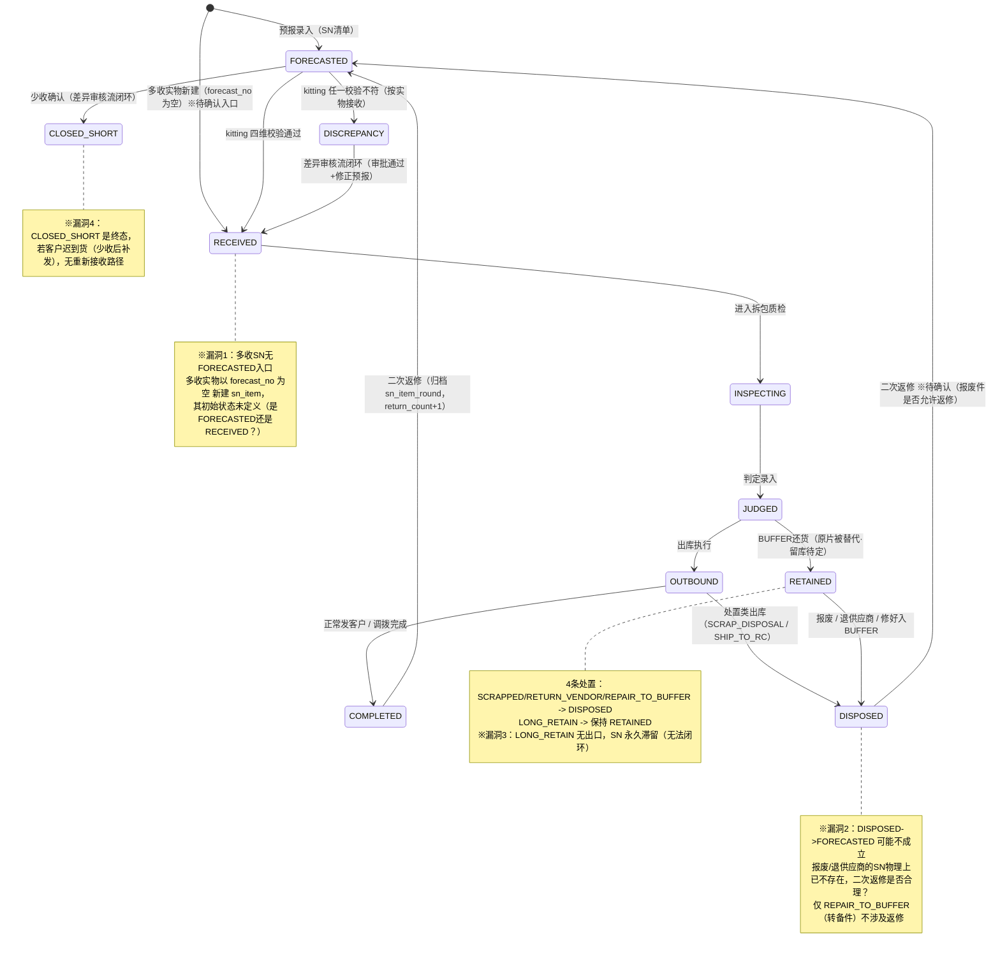
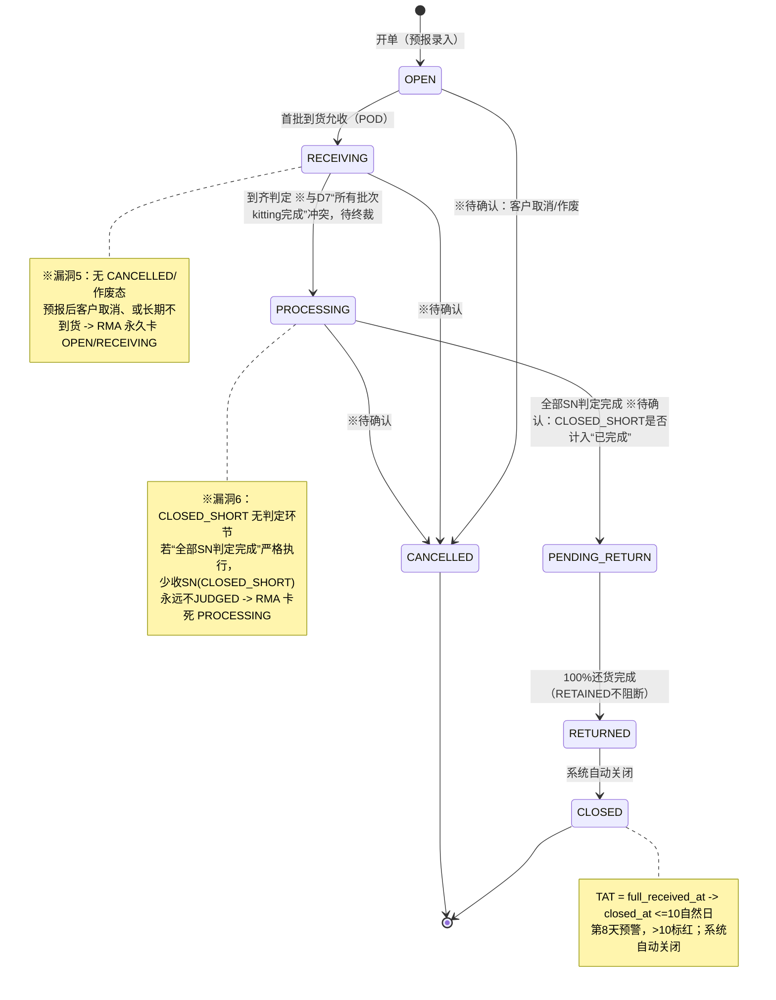

# BOE US RMA 收发管理系统 — 状态机与全链路专项评审（PRD V1.12）

| 项目 | 内容 |
|---|---|
| 评审对象 | PRD V1.12 两套状态机 + 全链路流程 |
| 评审维度 | SN状态机完整性 / RMA 6态流转 / 三段映射 / RETAINED闭环 / 差异流程 / 调拨 / CLOSED_SHORT / BUFFER |
| 评审人 | WMS/RMA 产品专家（智能体） |
| 日期 | 2026-11-03 |

---

## 〇、首要发现：D7 口径与 PRD 现口径冲突（必须先确认）

| 项 | 评审要求口径（本次） | PRD V1.12 现口径 |
|---|---|---|
| RECEIVING→PROCESSING 触发 | **该 RMA 所有批次 kitting 全部完成**（D7 原始定义） | **到齐判定：已收数量 + CLOSED_SHORT 数量 = 预报总量，且少收审核流闭环**（M-06 / L-04） |

**冲突影响**：两个规则数学上不等价。
- 「所有批次 kitting 完成」：批次数在货物到齐前不可知，系统无法判定"没有下一批了"→ 极易卡死在 RECEIVING；
- 「按预报总量判到齐」：可判定，能闭环。

**结论**：必须二选一作为唯一口径，否则 RECEIVING 推进逻辑无法编码。**待老丁终裁。**

---

## 一、修正版状态图（Mermaid，标注待确认漏洞）

### 1.1 SN 单品状态机（修正版）

### 1.2 RMA 级状态机（修正版）

---

## 二、流程风险清单

| 序号 | 流转卡点 | 会导致什么脏数据 | 待确认 |
|---|---|---|---|
| RK-01 | RECEIVING→PROCESSING：D7「所有批次kitting完成」vs M-06「预报总量到齐」双口径并存 | 推进条件二义，研发无法编码；按D7则批次数不可知导致 RECEIVING 永久卡死 | 二选一终裁 |
| RK-02 | PROCESSING→PENDING_RETURN「全部SN判定完成」，但 CLOSED_SHORT 的SN无判定 | RMA 永久卡在 PROCESSING，无法进入待还货 | CLOSED_SHORT 是否计入"判定完成" |
| RK-03 | 多收SN（forecast_no为空）新建 sn_item，初始状态未定义 | SN 状态非法/脏数据，轨迹从哪开始不明 | 多收SN初始状态 |
| RK-04 | DISPOSED→FORECASTED 二次返修 | 报废/退供应商的SN被二次返修，产生不存在的实物记录 | 报废件是否允许返修 |
| RK-05 | LONG_RETAIN 保持 RETAINED 无出口 | 原片永久滞留留库，库存与SN状态永不闭环 | 长期留库超期处理机制 |
| RK-06 | RMA 无 CANCELLED/作废态 | 取消单/死单永久卡 OPEN/RECEIVING，TAT 无限超期 | 是否需作废态 |
| RK-07 | 调拨对象状态未限定（仅L-02说RETAINED可调拨） | 未质检(RECEIVED)的SN直接调拨→COMPLETED，跳过质检判定 | 可调拨的状态白名单 |
| RK-08 | CLOSED_SHORT 后迟到货无回流 | 已关单SN实物又到，无接收路径，账实不符 | 迟到货处理 |
| RK-09 | REPAIR_TO_BUFFER：原片SN=DISPOSED 又进 buffer_stock=AVAILABLE | 同一物理SN双重身份（已处置 + 在库备件），数据冲突 | 是否允许同SN双身份 |
| RK-10 | BUFFER 还货发货时校验+扣减库存，无预留/并发控制 | 多单并发超扣/占用冲突，buffer 库存脏数据 | 库存预留机制 |
| RK-11 | 差异审批驳回→退回重扫，但 kitting 已提交锁定(KT-04) | 驳回后无法重扫（需受控修正），流程卡死 | 驳回解锁机制 |
| RK-12 | 跨PN buffer替代，客户收到不同PN替代品，M-03未要求客户确认 | 客户对账/验收争议 | 是否需客户确认 |
| RK-13 | "100%还货"判定依赖 return_record.returned_sn，但 buffer 件不进 sn_item | 还货计数口径（按SN还是按还货记录）不清，可能误判未100% | 还货计数口径 |

---

## 三、状态机死锁 / 无法闭环场景清单

| 序号 | 场景 | 死锁点 | 后果 |
|---|---|---|---|
| DL-01 | 按 D7「所有批次kitting完成」判 RECEIVING→PROCESSING | 批次数不可知，无法判定"全部完成" | RMA 永久卡 RECEIVING |
| DL-02 | 存在 CLOSED_SHORT 的 SN，且"全部SN判定完成"严格执行 | CLOSED_SHORT 永不 JUDGED | RMA 永久卡 PROCESSING |
| DL-03 | RETAINED 选择 LONG_RETAIN | 永久保持 RETAINED，无出口 | SN 永久留库，库存/状态不闭环 |
| DL-04 | 客户取消 / 预报后长期不到货 | 无 CANCELLED 态 | RMA 永久卡 OPEN/RECEIVING |
| DL-05 | 少收关单(CLOSED_SHORT)后客户补发迟到货 | 无回流路径 | 实物无法入账，账实不符 |
| DL-06 | 差异审批驳回后退回重扫 | kitting 已锁定 | 无法重扫，差异无法闭环 |
| DL-07 | BUFFER 发货时库存被并发占用 | 无预留 | 发货失败或超扣，还货卡住 |

---

## 四、结论

- 两套状态机主链完整，但存在 **1 个口径冲突（D7 vs M-06）+ 4 个状态机漏洞（多收入口/报废返修/LONG_RETAIN出口/无作废态）+ 7 个死锁场景**；
- 全部为评审抛点，未擅自修改业务规则；修正版状态图以"※待确认"标注，不替代终裁；
- 优先闭环：RK-01(D7口径) > RK-02(少收判定) > RK-03(多收入口) > RK-06(作废态)。
- **进度更新（V1.13 / V1.14）**：RK-01、RK-02、RK-03、RK-06 已于 V1.13 闭环；RK-04、RK-05、RK-07、RK-08、RK-09、RK-10、RK-11、RK-12、RK-13 已于 V1.14 闭环。**本文 RK-01~RK-13 全部闭环。**
