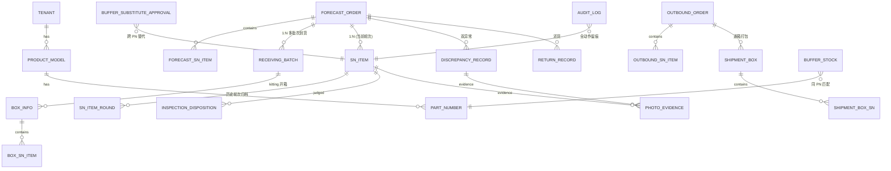

# 阶段2 — 架构与数据库设计

## 2.1 技术架构

```
┌──────────────────────────────────────────────┐
│ Browser（Web 后台 / 移动端 H5 / 扫码枪）        │
│ Vue3 + Element Plus + vue-router + axios      │
│ 中英双语 i18n · 分页 10/20/50/200 · 断网禁提交   │
└───────────────┬──────────────────────────────┘
                │ HTTPS / JSON（JWT Bearer）
┌───────────────▼──────────────────────────────┐
│ Go 1.22 + Gin                                 │
│  middleware: Auth(JWT) → Require(perm) → RBAC │
│  handler → service（事务/状态机/审计）           │
│  statemachine：SN 10 态 / RMA 6 态 唯一权威     │
│  seq：BOE/OB 双序列 + 通用单号                   │
└──────┬─────────────────────┬─────────────────┘
       │ GORM                │ S3 API
┌──────▼──────┐      ┌───────▼────────┐
│ MySQL 8.0   │      │ MinIO（对象存储） │
│ 23 张表      │      │ 原图 + 缩略图     │
└─────────────┘      └────────────────┘
```

**分层约束**
1. handler 只做参数绑定/响应，不含业务规则；
2. service 是唯一事务边界（`Service.Tx`），跨模块调用使用 `xxxTx(tx, ...)` 变体，禁止嵌套事务；
3. 所有状态变更必须经 `statemachine.CanSNTransit / CanRMATransit`；
4. 所有枚举在 `internal/enum` 常量固化，业务代码零裸字符串；
5. 所有关键动作写 `audit_log`（只增不删）。

## 2.2 ER 图（Mermaid）



## 2.3 表清单（23 张，全表 tenant_id）

| # | 表 | 说明 |
|---|---|---|
| 1 | tenant | 租户 |
| 2 | product_model | 机型 |
| 3 | part_number | 料号 |
| 4 | sys_user | 用户（5 角色） |
| 5 | forecast_order | 预报单 / RMA（含 TAT 字段） |
| 6 | forecast_sn_item | 预报 SN 明细（多 PN） |
| 7 | receiving_batch | 允收批次（POD/外箱标识数） |
| 8 | box_info | 收货箱（BOE 序列） |
| 9 | box_sn_item | 收货箱 SN |
| 10 | sn_item | SN 单品（核心，tenant+sn 唯一） |
| 11 | sn_item_round | SN 历史轮次 |
| 12 | discrepancy_record | 差异 + 双异常（不可删） |
| 13 | inspection_disposition | 质检判定 |
| 14 | outbound_order | 出库单 |
| 15 | outbound_sn_item | 出库明细 |
| 16 | shipment_box | 发货箱（OB 序列） |
| 17 | shipment_box_sn | 发货箱 SN |
| 18 | photo_evidence | 照片（≥2 年） |
| 19 | audit_log | 审计日志（不可删） |
| 20 | box_sequence | 箱号流水（RECEIVE/SHIP） |
| 21 | biz_sequence | 通用单号流水 |
| 22 | buffer_stock | 缓冲备件（AVAILABLE/RESERVED/OUT/SCRAPPED） |
| 23 | buffer_inbound_order / buffer_substitute_approval | 备件入库预报 / 跨 PN 审批 |

建表 DDL：`db/schema.sql`；枚举与初始数据：`db/enum_seed.sql`。

## 2.4 并发控制

| 场景 | 方案 |
|---|---|
| BUFFER 预占防超扣 | 事务内 **条件更新**：`UPDATE buffer_stock SET stock_status='RESERVED' WHERE tenant_id=? AND sn=? AND stock_status='AVAILABLE'`，`RowsAffected=0` 即冲突返回 409，配 `SELECT ... FOR UPDATE`（MySQL）双保险 |
| 箱号并发生成 | 事务内 `INSERT ... ON DUPLICATE KEY UPDATE current_no=current_no+1`（MySQL）/ `ON CONFLICT DO UPDATE`（SQLite），再回读；单日 >999 报错 |
| 状态脏写 | 所有状态变更走 `transit()`：行锁 + 状态机校验 + 条件更新，事务内完成 |
| 重复扫码 | `box_sn_item` / `shipment_box_sn` 主键唯一约束 + 应用层预检 |
| 审批并发 | 审批前后校验 `approval_status=PENDING`，更新带状态条件 |

## 2.5 权限中间件

`middleware.Auth` 解析 JWT → `middleware.Require(perm)` 查角色权限表（PRD 第 3 章矩阵硬编码，`rolePerms`）。
路由声明示例：`api.POST("/outbounds/:no/scrap-approve", middleware.Require(middleware.PermScrapApprove), h.ApproveScrap)`。
客户角色 **任何业务接口直接 403**（一期不开放，C-09）。

## 2.6 TAT 设计

- 起算 `full_received_at`：到齐判定成立时（`已收 + CLOSED_SHORT = 预报量` 且少收审批闭环）写入；
- 终点 `closed_at`：RMA 自动关闭同一时点写入；
- `tat_days = ceil((closed_at - full_received_at)/24h)`；`>=8` 置 `tat_warning`，`>10` 置 `tat_overdue`；
- `POST /reports/tat-refresh` 供定时任务批量刷新在途 RMA 的预警标记。
